# Cómo crear un servidor web en Debian con WordPress y MariaDB

En esta guía vamos a usar Debian como servidor para alojar una página web hecha con WordPress y conectarla con una base de datos en MariaDB.

## PASO 1: Instalar Apache

El primer paso será instalar Apache.

>Apache es un servidor web que permite publicar páginas web y aplicaciones en un equipo o servidor.

Pero antes de eso, debemos descargar y actualizar los paquetes disponibles. Para ello, abriremos una terminal en Debian y escribiremos:

`sudo apt update && sudo apt upgrade -y`

Después ejecutaremos el siguiente comando para instalar Apache:

`sudo apt install apache2`

Para comprobar que se ha instalado correctamente, usaremos:

`sudo systemctl start apache2`

Si aparece "enabled" y "active (running)" significa que Apache está habilitado y funcionando:

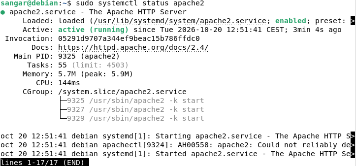

Para comprobar la versión instalada:

`apache2 -v`

Si no estuviera iniciado, usaremos:

`sudo systemctl start apache2`

Si queremos detener el servidor:

`sudo systemctl stop apache2`

Para que Apache arranque automáticamente cuando se inicie Debian, usaremos:

`sudo systemctl enable apache2`

Si vamos a cualquier navegador, por ejemplo, a Firefox, y en la barra de direcciones escribimos `http://localhost` deberíamos ver esto:

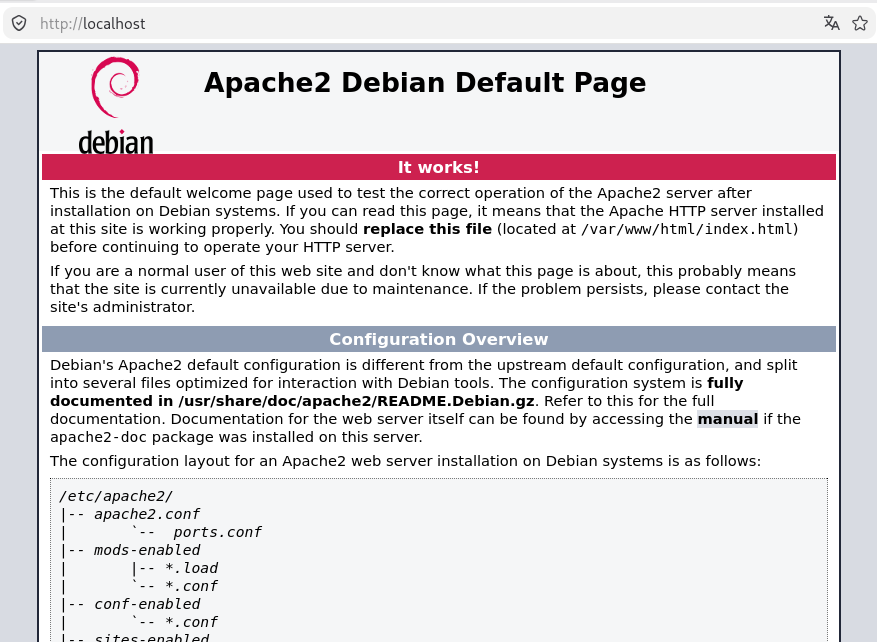

Y si nos movemos por comandos hasta la carpeta raíz, dentro de **/var** se habrá creado una carpeta **/www**

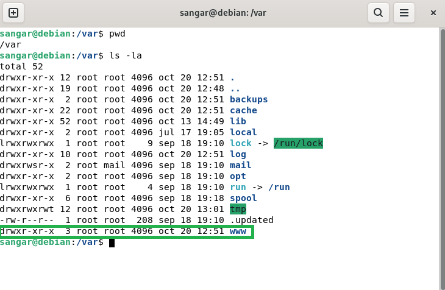

Y dentro de **/www** podemos encontrar un directorio **/html**:

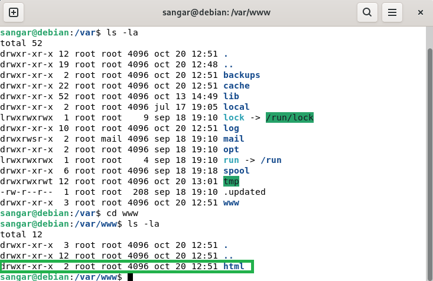

Dicho directorio contiene un **index.html** que es precisamente la web que nos carga cuando entramos a http://localhost

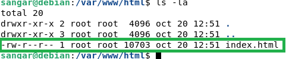

Este es el directorio donde alojaremos la web de WordPress.

Otra cuestión a considerar: ahora mismo, dicho fichero index.html está en local, es decir, no es accesible desde internet. Más adelante en esta guía, veremos cómo hacerlo.

## PASO 2: Instalar MariaDB

Lo siguiente que haremos será instalar el gestor de base de datos MariaDB, de la siguiente forma:

En una terminal escribiremos `sudo apt install mariadb-server`

Una vez se realice la instalación, usaremos el comando `sudo systemctl status mariadb` para verificar que el servicio está habilitado y funcionando. Con `sudo systemctl status mysql` también se puede. Deberíamos ver esto:

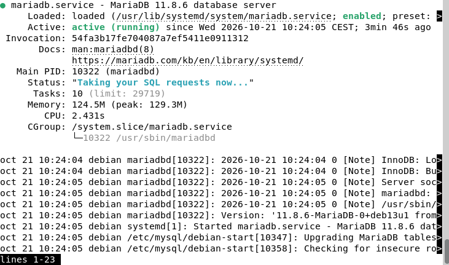

Primero, cambiaremos al usuario root para obtener permisos de administrador del sistema. Para ello, ejecutaremos el comando `sudo su` e introduciremos la contraseña de nuestro usuario.

A continuación, ejecutaremos el comando `mysql -u root -p` para acceder al servidor de bases de datos MariaDB utilizando el usuario root. Cuando se nos solicite, introduciremos la contraseña correspondiente.

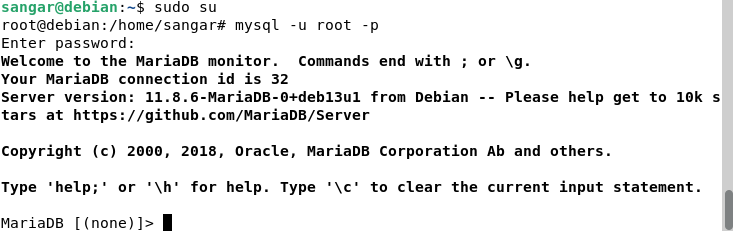

Ahora que ya tenemos acceso a la base de datos, vamos a crear una:

`create database wordpress DEFAULT character set utf8mb4 collate utf8mb4_unicode_ci;`

Donde:

* `default character set utf8mb4` significa que se pueden escribir letras con tildes, la letra 'ñ', caracteres en otros idiomas y emojis.

* `collate utf8mb4_unicode_ci` define cómo MariaDB compara y ordena los textos.

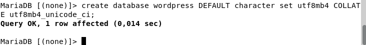

Comprobaremos que la base de datos ha sido creada: `show databases;`

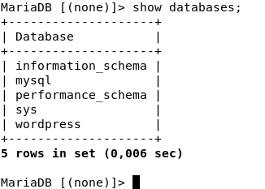

Una vez creada la base de datos, crearemos un usuario:

`create user 'wpuser'@'localhost' identified by 'wordpress';`

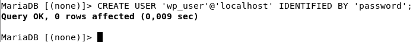

Le daremos todos los privilegios a dicho usuario:

`grant all privileges on wordpress.* to 'wp_user'@'localhost';`

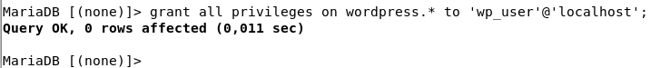

Aplicamos cambios: `flush privileges;`

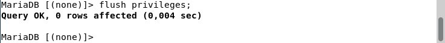

Saldremos del gestor usando: `exit`

## PASO 3: Instalar PHP

Ahora que ya tenemos instalado MariaDB como gestor de base de datos, necesitamos instalar PHP, ya que es el lenguaje de programación que utiliza WordPress para ejecutar la lógica de la página web y comunicarse con la base de datos.

Para instalar PHP escribiremos el siguiente comando:

`sudo apt install php libapache2-mod-php php-mysql php-gd php-xml php-mbstring php-curl php-zip php-intl unzip`

Donde:

* `libapache2-mod-php`: Integra PHP directamente con el servidor web Apache
* `php-mysql`: Permite a PHP conectarse a MySQL y MariaDB.
* `php-gd`: Permite procesar y modificar imágenes.
* `php-xml`: Permite trabajar con documentos XML.
* `php-mbstring`: Permite manejar cadenas de texto con distintos juegos de caracteres.
* `php-curl`: Permite realizar peticiones a otros servidores mediante HTTP y otros protocolos.
* `php-zip`: Permite a PHP trabajar con archivos ZIP.
* `php-intl`: Permite formatear fechas y horas, números y monedas, ordenar y comparar texto, y trabajar con formatos internacionales.
* `unzip`: Permite extraer archivos ZIP desde la terminal.

Existen otras extensiones de PHP y utilidades complementarias, pero para esta guía solo usaremos estas.

Luego deberemos reiniciar Apache para que se apliquen los cambios, escribiendo:

`sudo systemctl restart apache2`

## PASO 4: Descargar e instalar WordPress

Antes de instalar WordPress, vamos a movernos desde la terminal al directorio **/tmp**

Desde ahí nos descargaremos WordPress, mediante el comando:

`wget https://wordpress.org/latest.tar.gz`

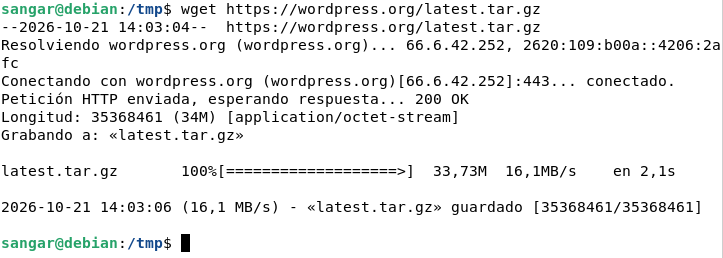

Haremos un `ls -la` para ver el nombre del fichero, y observamos que el nombre es "latest.tar.gz":

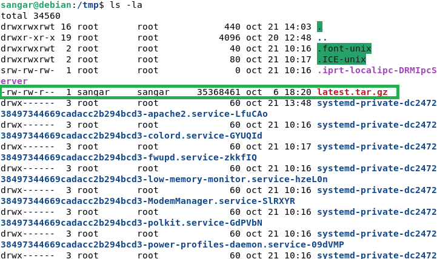

Al ser un fichero comprimido, tenemos que descomprimirlo. Esto lo haremos usando:

`tar -xf latest.tar.gz`

Donde:

* `x`: Extraer los archivos
* `f`: Indicar el nombre del archivo.

Si hacemos un `ls -la` en **/tmp**, debería aparecer una carpeta llamada "wordpress":

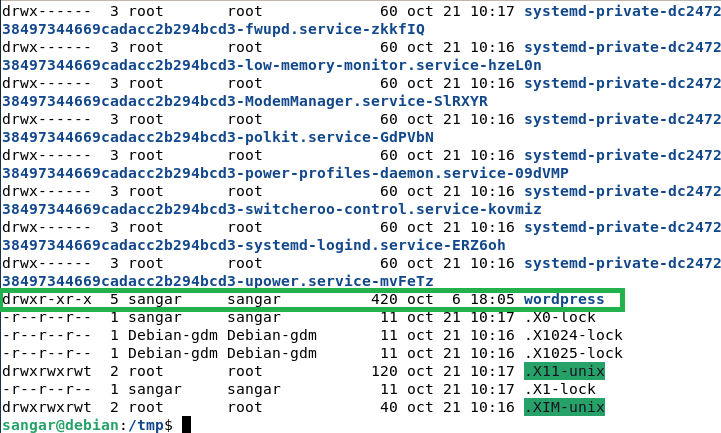

Ahora debemos copiar dicha carpeta en el directorio **/var/www/html/wordpress**, pero como en **/var/www/html** no existe la carpeta **wordpress**, primero debemos crearla usando:

`sudo mkdir -p /var/www/html/wordpress`

Una vez hagamos eso, ya podremos copiar el directorio:

`sudo cp -r /tmp/wordpress/* /var/www/html/wordpress/`

Si vamos al directorio **/var/www/html/wordpress** y escribimos `tree -L 1` veremos algo como esto:

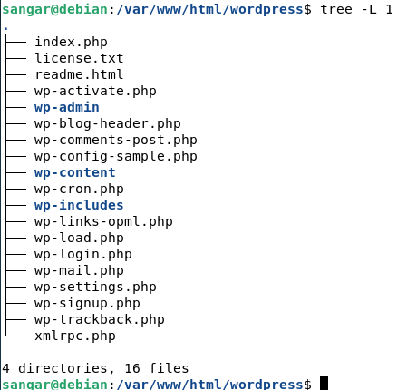

## PASO 5: Cambiar propiedad y permisos

Si estando en **/var/www/html/wordpress** hacemos un `ls -la` observaremos que el usuario y grupo con propiedad de los archivos es **root**:

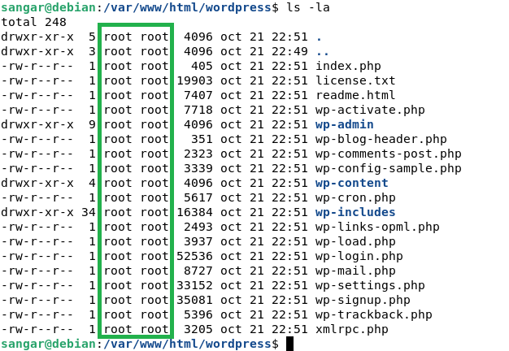

Es importante tener en cuenta esto, ya que Apache suele ejecutarse con el usuario **www-data** en Debian y Ubuntu. Si WordPress necesita instalar temas o plugins, tendremos que configurar las propiedades adecuadamente.

>El servidor debe ser el propietario.

Para cambiarlas, usaremos:

`sudo chown -R www-data:www-data /var/www/html/wordpress`

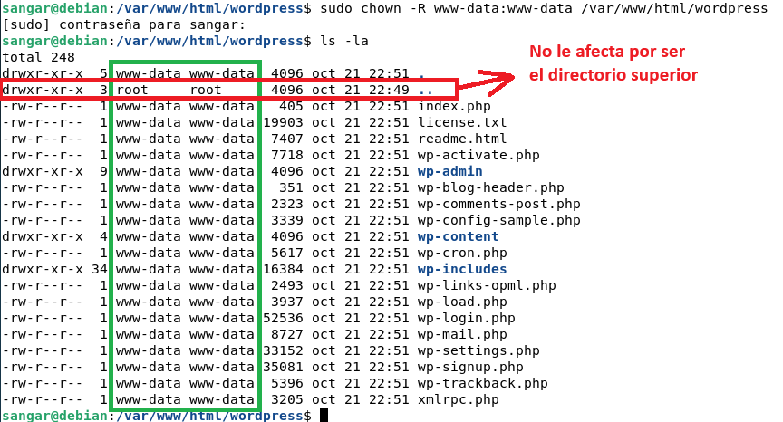

El cambio afecta a todos los ficheros y carpetas contenidos en el directorio **wordpress**, pero no al directorio superior, representado por dos puntos.

Ahora que hemos cambiado el propietario, vamos a buscar todos los directorios contenidos en **wordpress** y les vamos a asignar permisos 755 (los tengan o no), es decir:

* Propietario: Leer (4) + escribir (2) + ejecutar (1)
* Grupo: Leer (4) + ejecutar (1)
* Otros: Leer (4) + ejecutar (1)

`sudo find /var/www/html/wordpress/ -type d -exec chmod 755 {} \;`

Después haremos lo mismo con los ficheros contenidos en el directorio **wordpress**, por medio del siguiente comando:

`sudo find /var/www/html/wordpress/ -type f -exec chmod 644 {} \;`

* Propietario: Leer (4) + escribir (2)
* Grupo: Leer (4) + ejecutar (1)
* Otros: Leer (4) + ejecutar (1)

## PASO 6: Configurar el acceso a la base de datos

Dentro del directorio **wordpress** hay un fichero llamado **wp-config-sample.php** que vamos a copiar, renombrar como **wp-config.php** y modificar.

Siendo root (`sudo su`), escribiremos: `cp wp-config-sample.php wp-config.php`

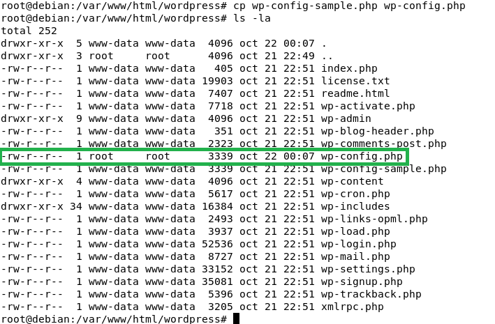

Abriremos el fichero: `nano wp-config.php` y unas líneas más abajo veremos Database settings. Lo modificaremos para que quede de la siguiente manera:

* DB_NAME: **wordpress**
* DB_USER: **wp_user**
* DB_PASSWORD: **password**
* DB_HOST: **localhost**

>He puesto como DB_PASSWORD "password" a modo de ejemplo para esta guía, pero lo ideal es poner una contraseña robusta.

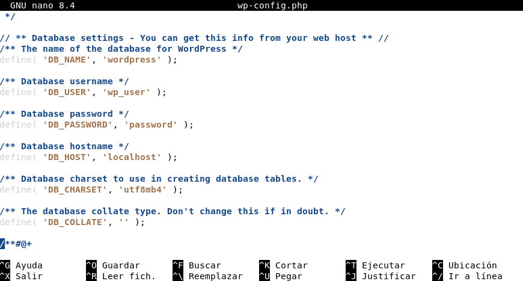

## PASO 7: Configuraciones adiccionales

Nos faltan unas pocas configuraciones más para tener listo WordPress.

Lo siguiente que debemos hacer es decirle a Apache dónde tiene su configuración. Para ello vamos a crear un fichero llamado **wordpress.conf** en la carpeta **/etc/apache2/sites-available**:

`cd /etc/apache2/sites-available`

`ls -la`

`cp 000-default.conf wordpress.conf`

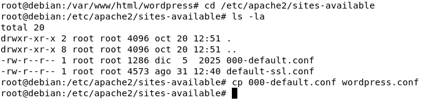

Lo abriremos con `nano wordpress.conf` y lo dejaremos de la siguiente manera:

```XML
<VirtualHost *:80>

        ServerAdmin webmaster@localhost
        DocumentRoot /var/www/html/wordpress
        #ServerName dominio.com
        <Directory "/var/www/html/wordpress/">
                AllowOverride All
                Options FollowSymLinks
                Require all granted
        </Directory>
        ErrorLog ${APACHE_LOG_DIR}/error.log
        CustomLog ${APACHE_LOG_DIR}/access.log combined

</VirtualHost>
```

>Consejo: Usar **CTRL + K** para borrar líneas innecesarias.

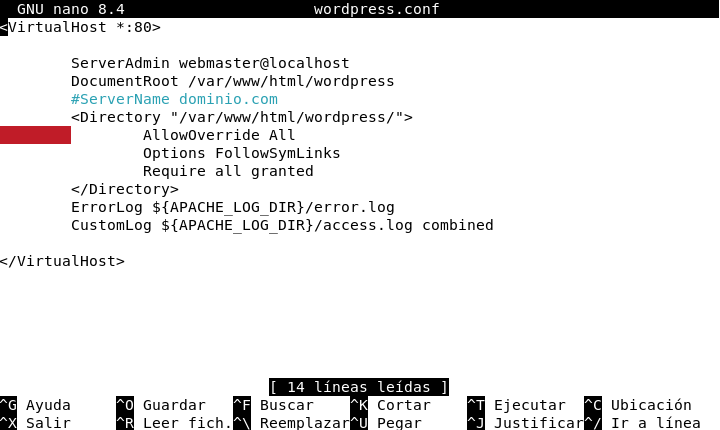

Apache suele guardar las configuraciones de los sitios web en la carpeta **/etc/apache2**

Entraremos a dicha carpeta donde veremos una serie de ficheros de configuración, y activaremos la configuración del sitio web de WordPress en Apache, usando: `sudo a2ensite wordpress.conf` y después `sudo a2enmod rewrite` que sirve para habilitar el módulo *mod_rewrite* que es el que permite reescribir las URL de las peticiones y que sean "más amigables".

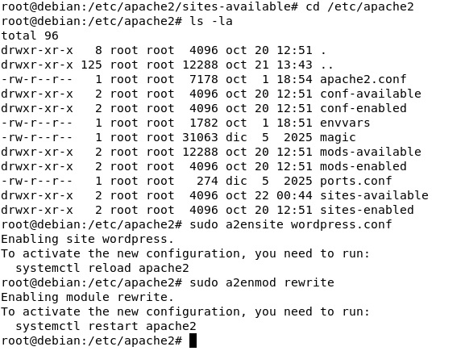

Finalmente reiniciaremos Apache para que arranque con la nueva configuración:

`systemctl restart apache2`

De este modo, si abrirmos un navegador y escribimos http://localhost/wordpress nos redigirá a http://localhost/wordpress/wp-admin/install.php y podremos empezar a crear nuestra web:

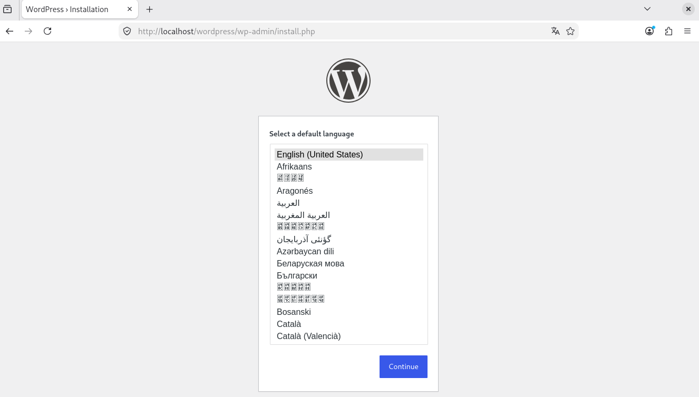