# Cómo instalar WordPress en Docker junto con MySQL Workbench


En esta guía vamos a ver cómo usar Docker para instalar Wordpress usando como gestor de base de datos MySQL Workbench.

## PASO 1

Crearemos una carpeta del proyecto donde crearemos un fichero llamado **wordpress_mysql.yml**

Dentro de dicho fichero escribiremos el siguiente código:

```
services:

  wordpress:
    image: wordpress
    restart: always
    ports:
      - 8080:80
    environment:
      WORDPRESS_DB_HOST: db
      WORDPRESS_DB_USER: exampleuser
      WORDPRESS_DB_PASSWORD: examplepass
      WORDPRESS_DB_NAME: exampledb
    volumes:
      - wordpress:/var/www/html

  db:
    image: mysql:8.0
    restart: always
    ports:
      - 3308:3306
    environment:
      MYSQL_DATABASE: exampledb
      MYSQL_USER: exampleuser
      MYSQL_PASSWORD: examplepass
      MYSQL_RANDOM_ROOT_PASSWORD: '1'
    volumes:
      - db:/var/lib/mysql

volumes:
  wordpress:
  db:
```

A continuación, desde la terminal de Docker escribiremos:

```
docker compose -f wordpress_mysql.yml up -d
```

Este comando descargará las imágenes de WordPress y MySQL, se creará un contenedor para cada uno de ellos y se crearán sus respectivos volúmenes, de modo que aunque se borren los contendores, la información quedará guardada (persistencia).

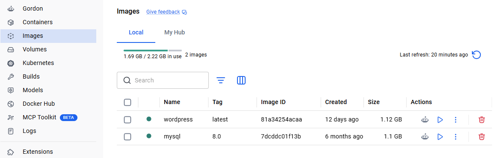
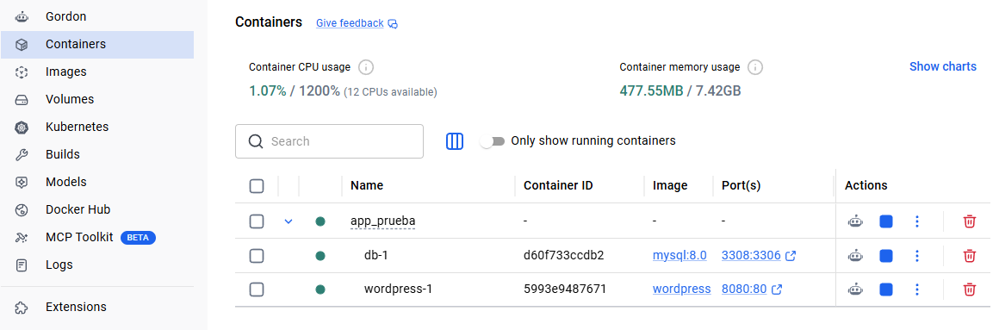
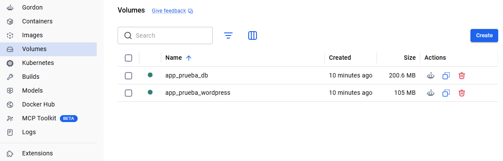

Ahora vamos a **Containers** y hacemos "click" en **8080:80**

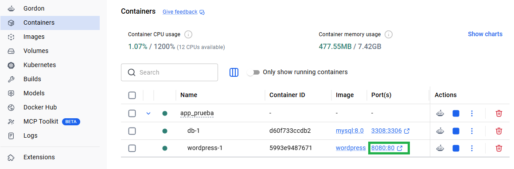

Debería abrirse una pestaña de navegador con la dirección "**http://localhost:8080/wp-admin/install.php**" y esto es lo que veremos:

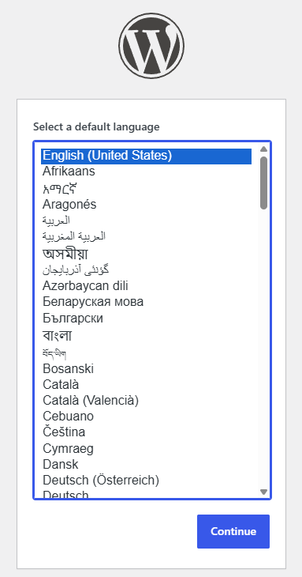

## PASO 2

Para continuar con esta guía, debes tener previamente instalado MySQL Workbench.

Si no lo tienes instalado, te invito a que mires este tutorial donde lo explico: [Cómo instalar MySQL Server y MySQL Workbench en Windows](https://github.com/miguel-sangar/Practicas/tree/main/Bases%20de%20datos/MySQL/C%C3%B3mo%20instalar%20MySQL%20Server%20y%20MySQL%20Workbench%20en%20Windows)

Si ya lo tienes instalado, haremos lo siguiente:

En Workbench añadiremos una nueva conexión pulsando en "+":

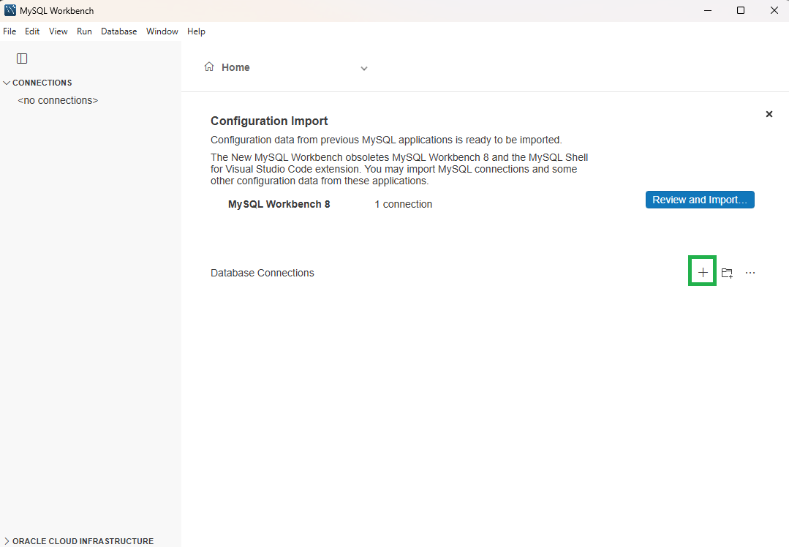

Se abrirá la siguiente ventana y rellenaremos los siguientes campos de la siguiente manera:

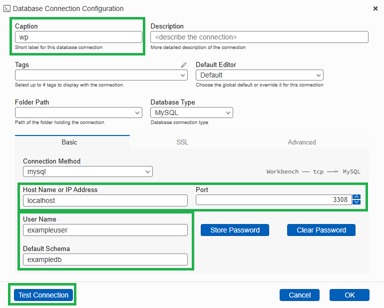

* Caption: **wp** (nombre de la conexión)
* Host Name or IP Address: **localhost**
* Port: **3308**
* User Name: **exampleuser**
* Default Schema: **exampledb**

Estos datos vienen definidos en el fichero **wordpress_mysql.yml**

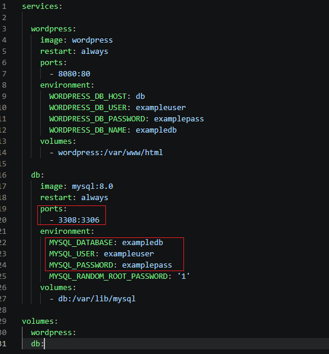

Tras rellenar dichos datos, pulsaremos en "Test Connection" e introduciremos la contraseña, que tal y como está definido en el fichero .yml es **examplepass**

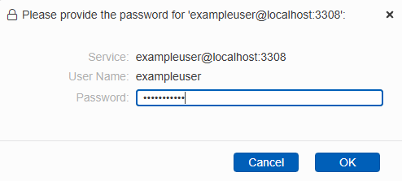

Le decimos que sí:


Ahora que ya se ha creado la conexión, le haremos doble "click":

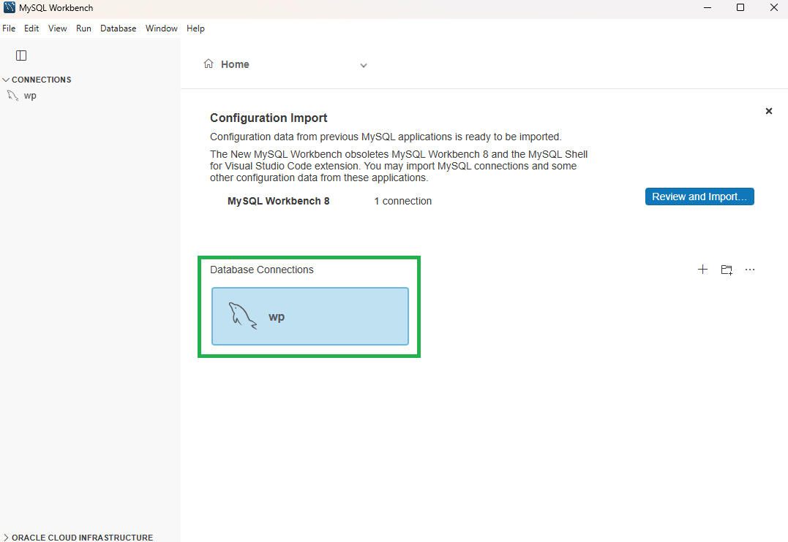

Y se abrirá la interfaz de la conexión:

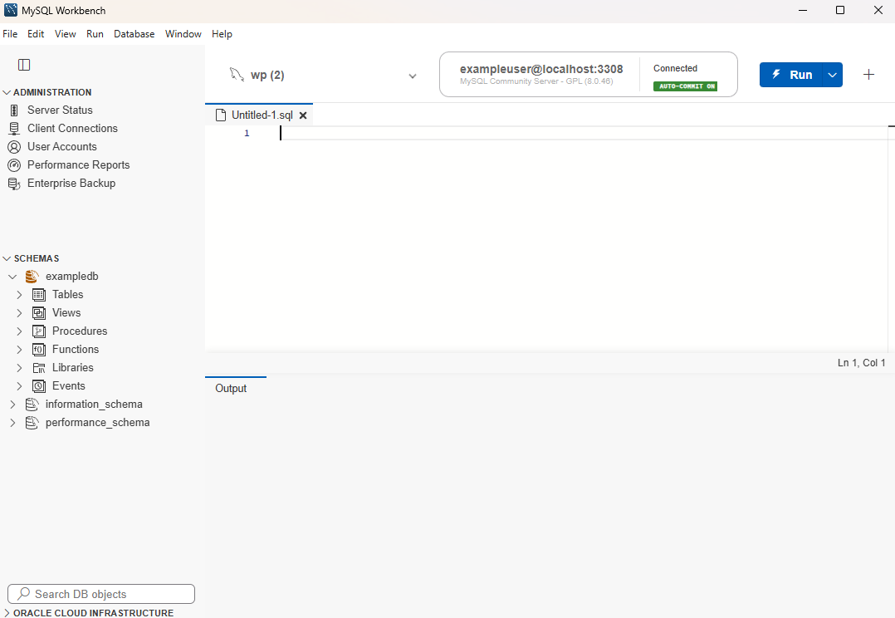

Con esto ya tendríamos WordPress instalado en Docker y conectado a una base de datos de MySQL.