# Cómo instalar PostgreSQL en Windows

En esta guía vamos a ver cómo instalar el sistema de gestión de base de datos PostgreSQL en Windows gracias a la interfaz gráfica que ofrece pgAdmin.

El primer paso será ir a la web oficial: https://www.postgresql.org/download/ y seleccionar como sistema operativo Windows:

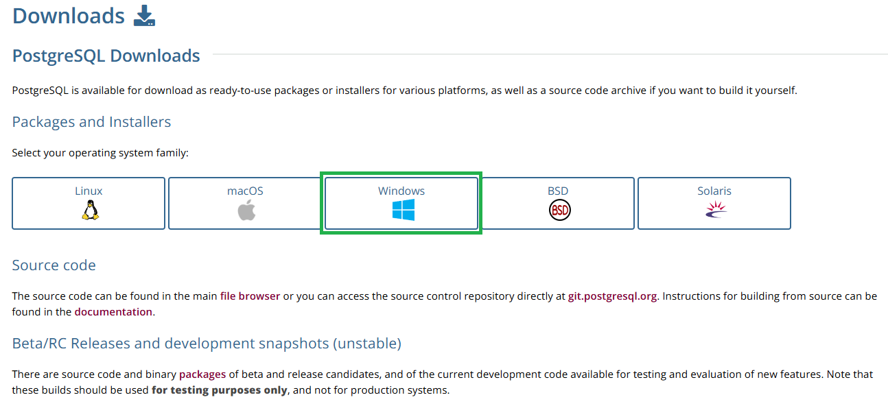

A continuación haremos "click" donde dice **Download the installer**:

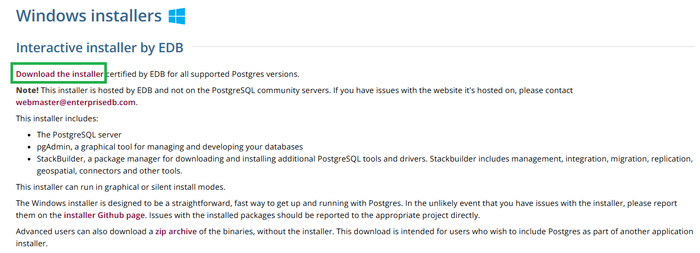

Descargaremos la última versión que haya disponible:

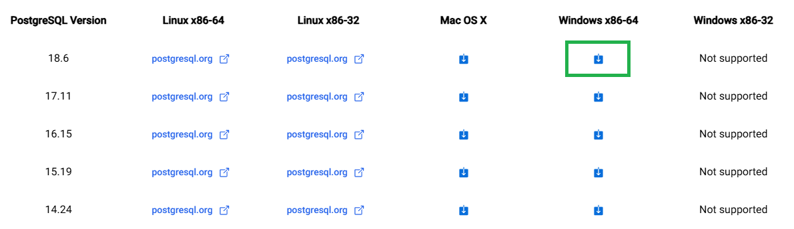

Una vez finalice la descarga, haremos doble "click" para ejecutar el instalador, y nos aparecerá esta ventana:

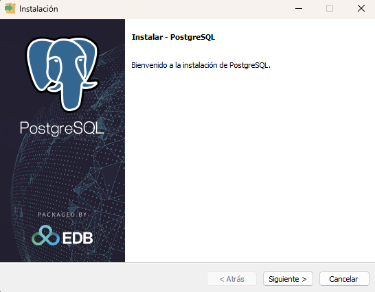

Tras darle a "Siguiente", dejaremos la ruta de instalación que se muestra por defecto:

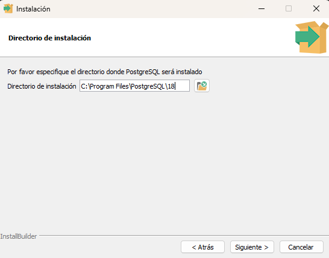

En la siguiente ventana dejaremos activos los componentes que vienen por defecto:

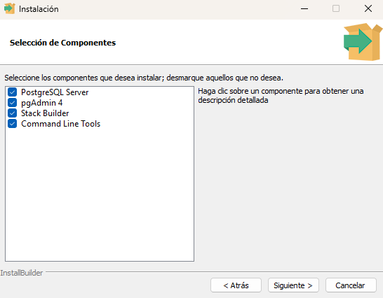

A continuación, dejaremos el directorio que viene por defecto:

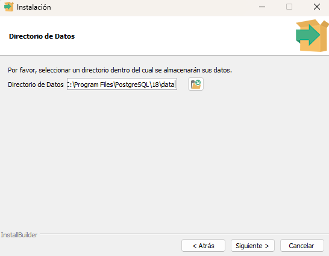

Luego tendremos que especificar una contraseña y confirmarla:

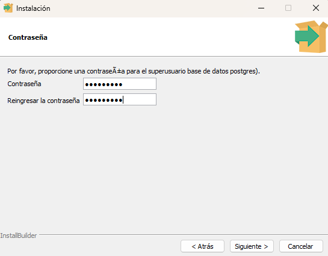

Por último, dejaremos por defecto el puerto 5432:

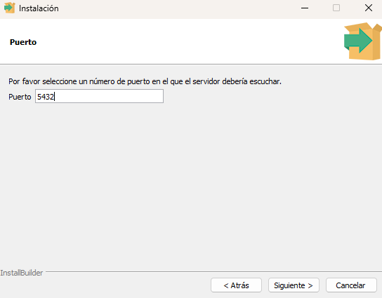

En configuración regional podemos dejarlo en **DEFAULT**:

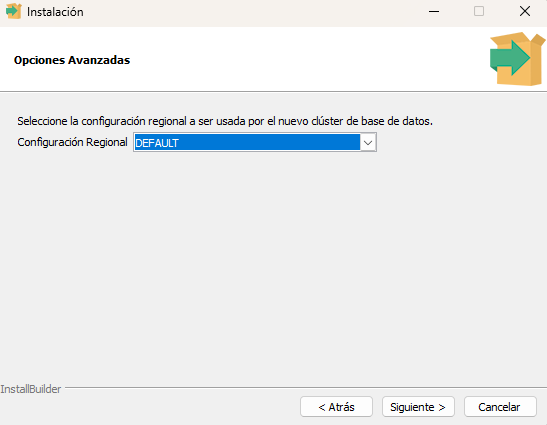

En la siguiente ventana, le daremos a "Siguiente":

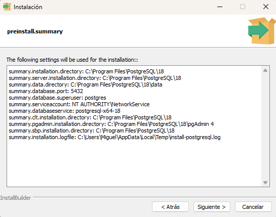

Tras volver a dar "Siguiente" empezará la instalación:

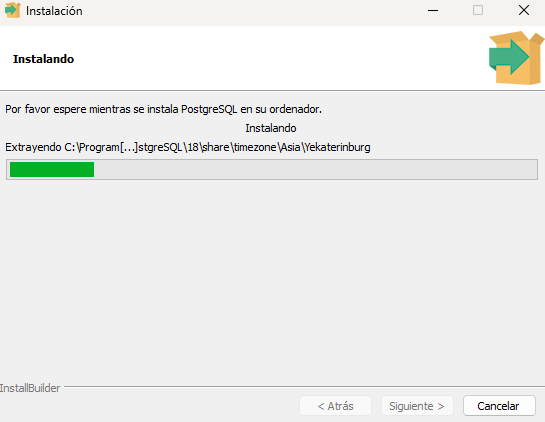

Quitamos la opción que por defecto viene marcada y pulsamos en "Terminar":

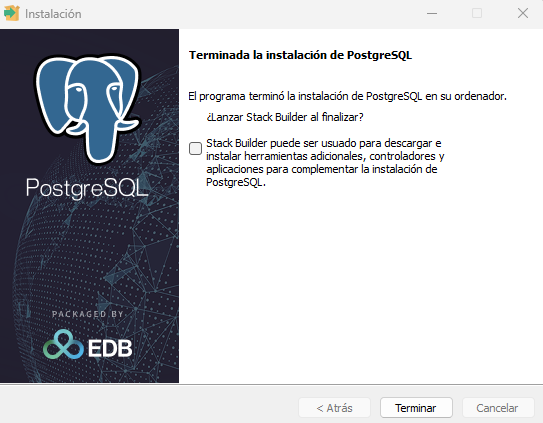

Se ejecutará pgAdmin 4 y ya tendremos acceso a la interfaz gráfica para gestionar las bases de datos:

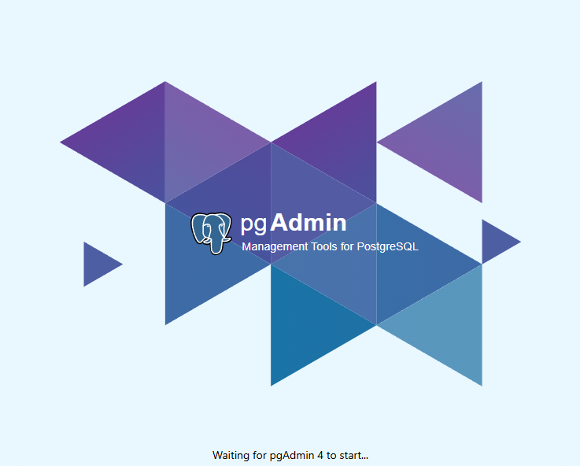
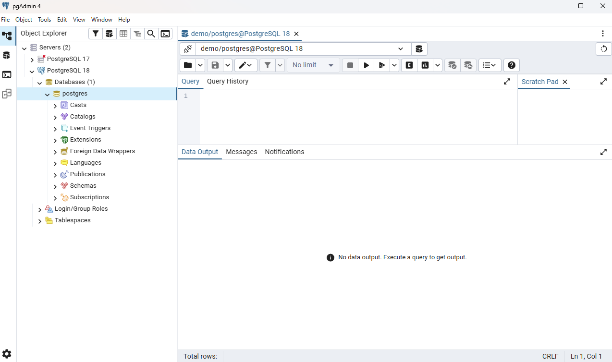

