# 01 - Cómo crear un Active Directory en Windows Server

En este documento voy a explicar qué es Active Directory, cómo crear y configurar uno para el sistema operativo Windows Server y conceptos básicos necesarios para gestionarlo.

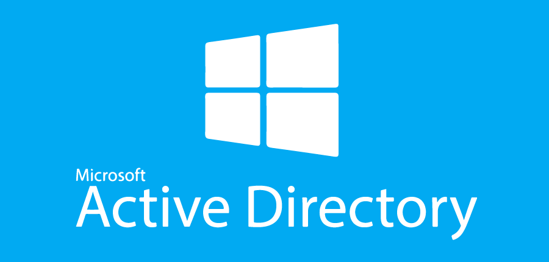

## ¿Qué es un Active Directory?

Un directorio activo es una base de datos jerárquica y centralizada de una organización, que almacena recursos de red (usuarios, grupos, equipos y sus permisos) que permite gestionarlos y localizarlos de forma unificada.

Gracias a un directorio activo, los usuarios pueden iniciar sesión con las mismas credenciales en cualquier equipo de la red. El protocolo estándar de acceso a los directorios es LDAP (Lighweight Directory Access Protocol) y define cómo consultar y modificar el directorio.

## ¿Qué es un controlador de dominio?

Un controlado de dominio (Domain Controler) es el servidor que aloja el servicio de directorio, autentica a usuarios y equipos, y replica la base de datos. Se despliegan varios para permitir la alta disponibilidad del dominio (redundancia).

Para conseguir alta disponibilidad, un dominio suele tener varios controladores de dominio que replican entre sí la base de datos del directorio, de modo que si un servidor se cae, otros siguen activos (redundancia).

## ¿Cómo crear un Active Directory en Windows Server?

En Windows Server abrimos el **Administrador del servidor** y en el menú izquierdo pulsamos sobre **Servidor local**. Cambiamos el nombre del equipo. Nos pedirá reiniciar:

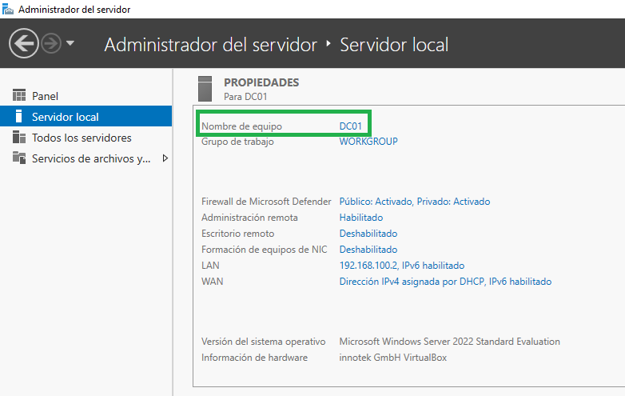

Una vez reiniciado el equipo, volveremos a esa ventana y asignaremos los nombres **LAN** a la que tenga la IP estática y **WAN** a la que da salida a la red:

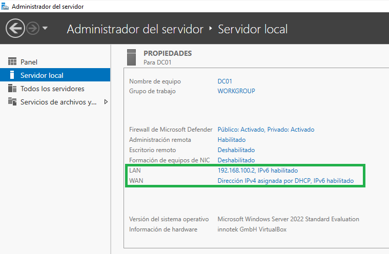

Lo siguiente que debemos hacer es instalar el rol de Active Directory. Se puede hacer de las dos formas en que se muestra en la siguiente imagen:

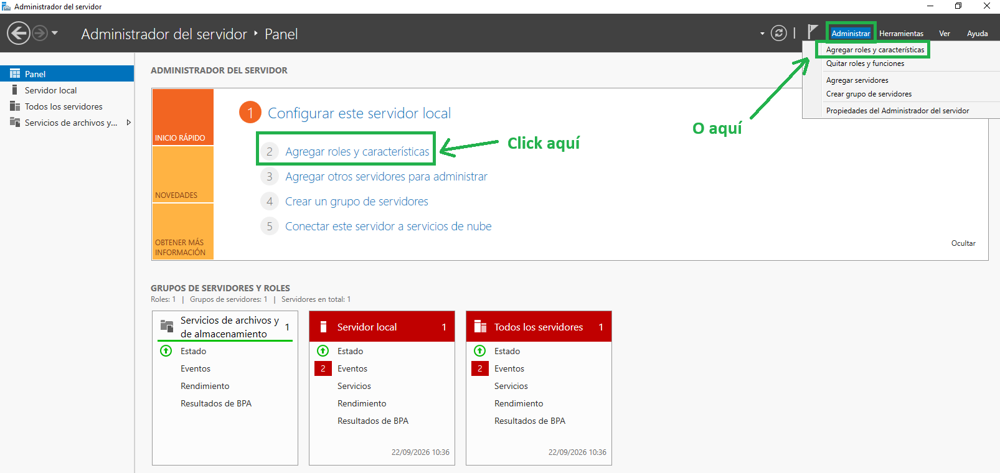

Seguir los pasos que se muestran a continuación:

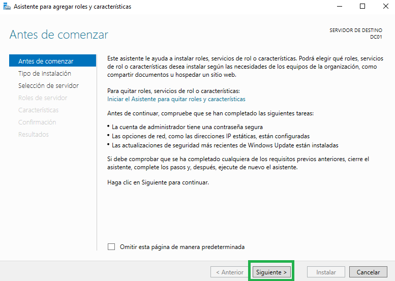
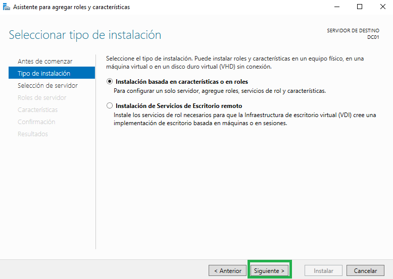
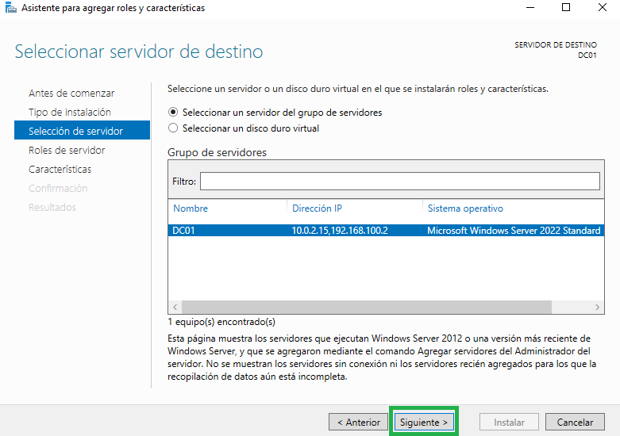
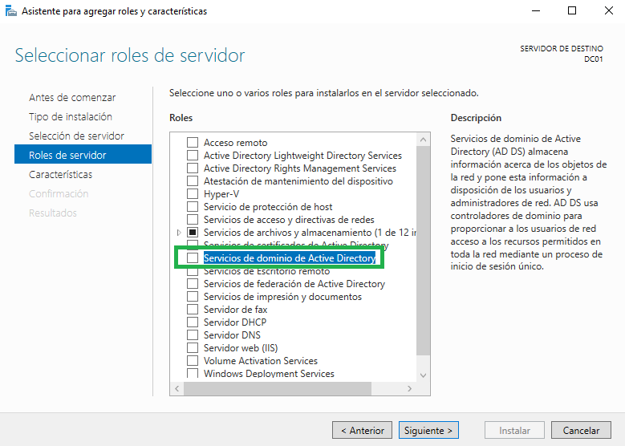
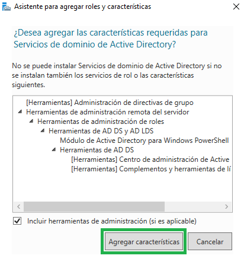
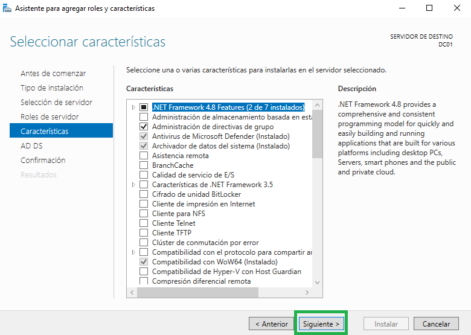
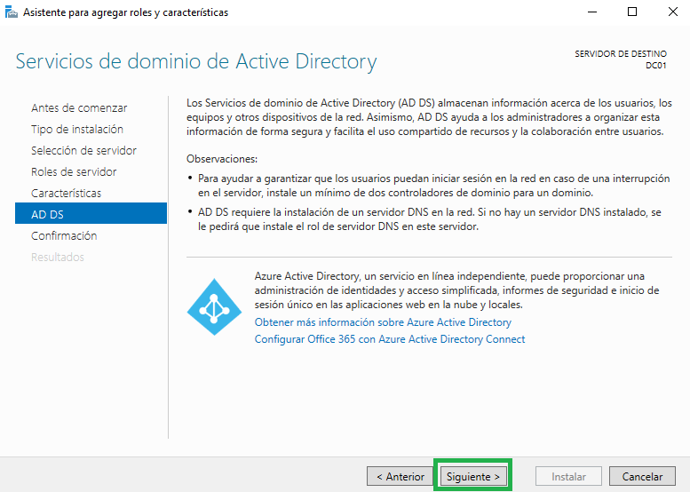
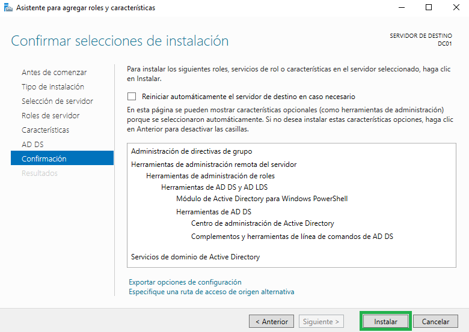

Tras finalizar la instalación del directorio activo, tenemos que elegir qué servidor va a controlar el dominio. Para ello, tenemos que pulsar sobre el icono de la bandera que hay en la parte superior derecha que tiene el símbolo de alerta amarilla y pulsar en **Promover este servidor a controlador de dominio**:

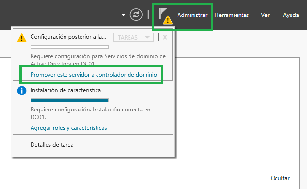

Se nos abrirá una ventana. Agregaremos un nuevo bosque y asignaremos un nombre al dominio raíz:

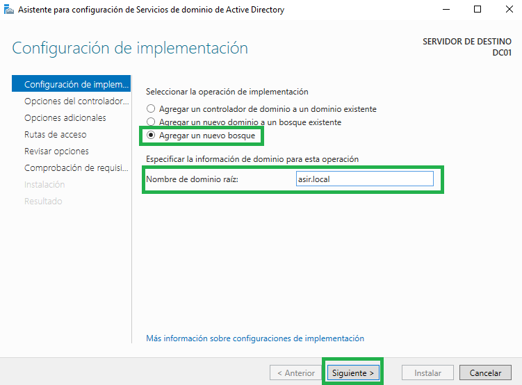
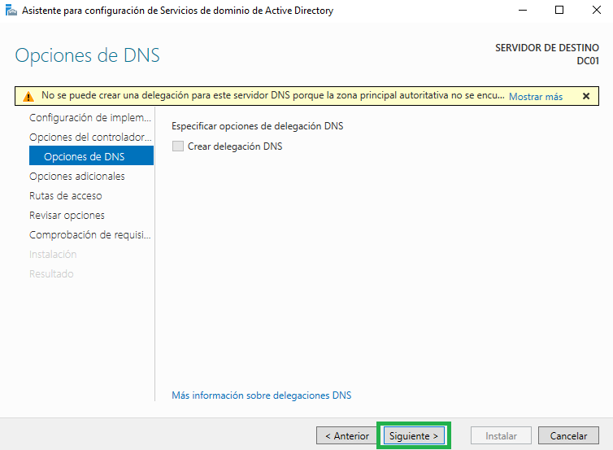
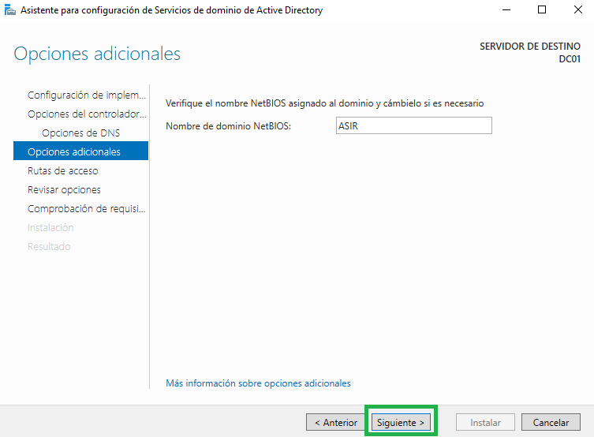
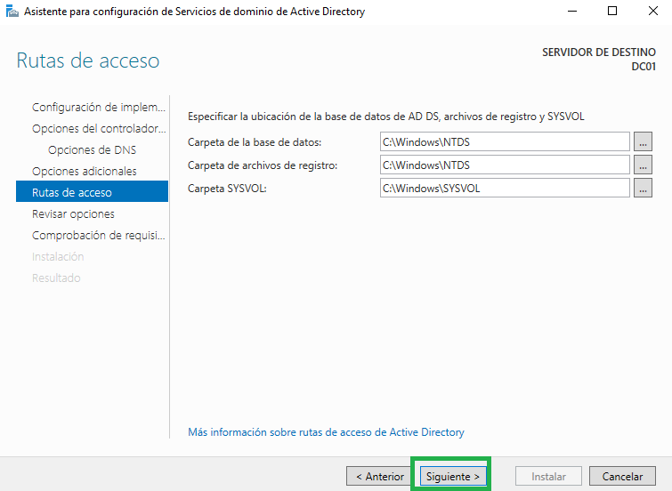
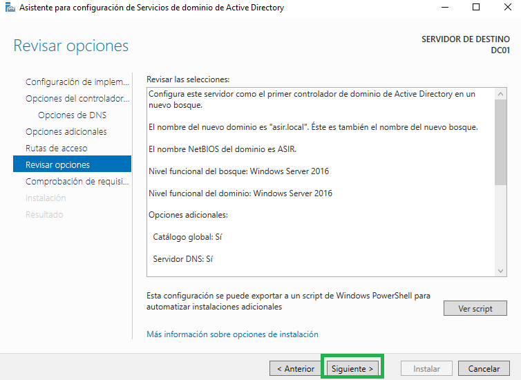
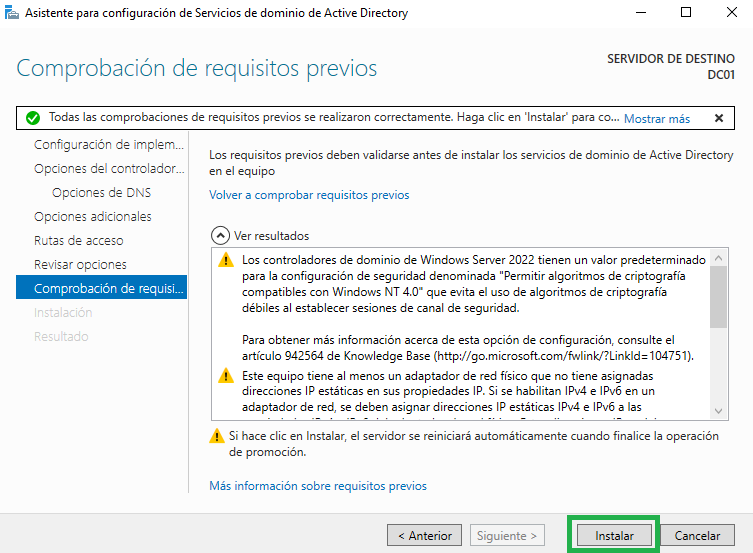

Tras el proceso de instalación, el servidor se reiniciará automáticamente.
Al iniciar sesión, veremos que ya nos muestra el nombre de dominio como raíz:

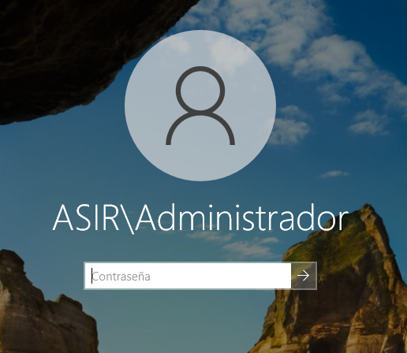
