# 04 - Cómo crear usuarios y administrar permisos

Primero iremos a **Herramientas** → **Usuarios y equipos de Active Directory**.
Se nos abrirá una ventana y haremos “click” en cualquier unidad organizativa.
Para este ejemplo, lo haré sobre **Ventas** → **Nuevo** → **Usuario**:

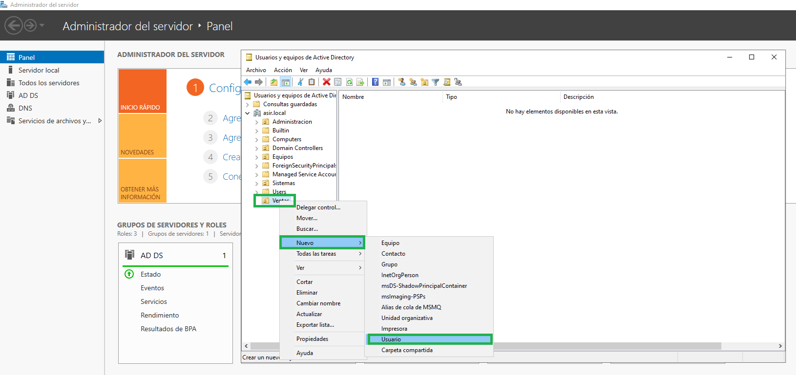

Rellenaremos el nombre y apellido, pudiendo insertar tildes; sin embargo, a la hora de especificar el nombre de inicio de sesión, lo haremos sin tildes:

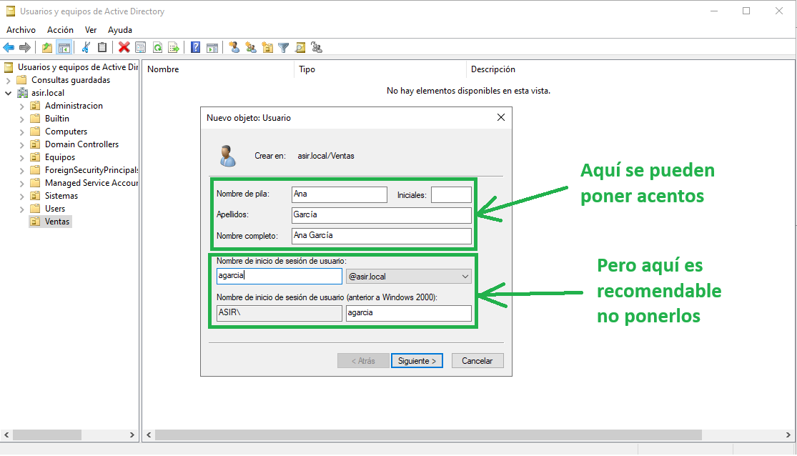

Tras pulsar “Siguiente” nos pedirá que pongamos una contraseña y la confirmemos.
También podemos deshabilitar la opción **El usuario debe cambiar la contraseña en el siguiente inicio de sesión** que por defecto está habilitada.

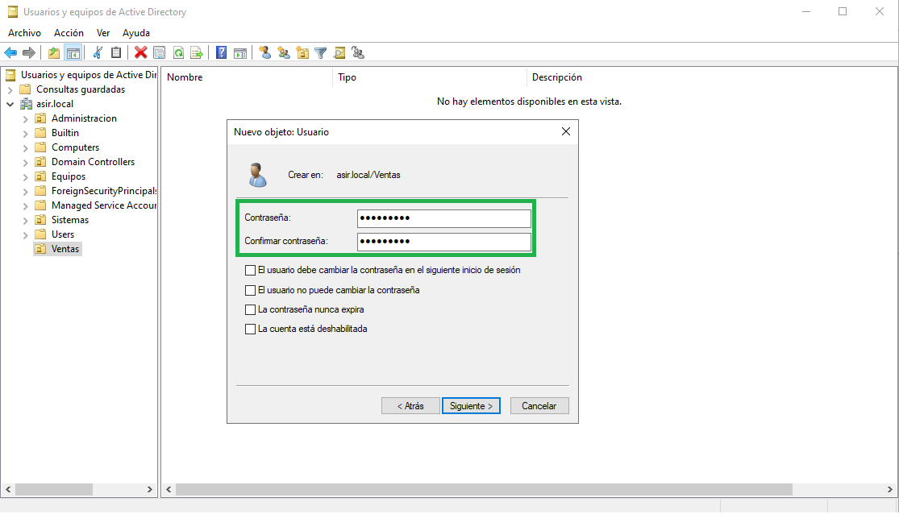

Con esto, ya estaría el nuevo usuario creado:

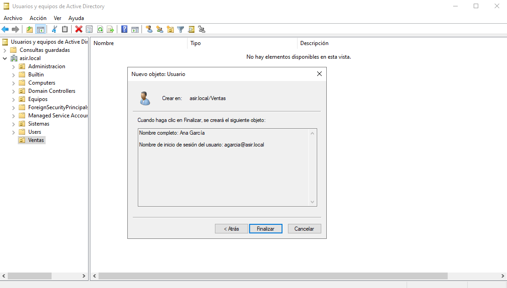

Y está añadido a la unidad organizativa:

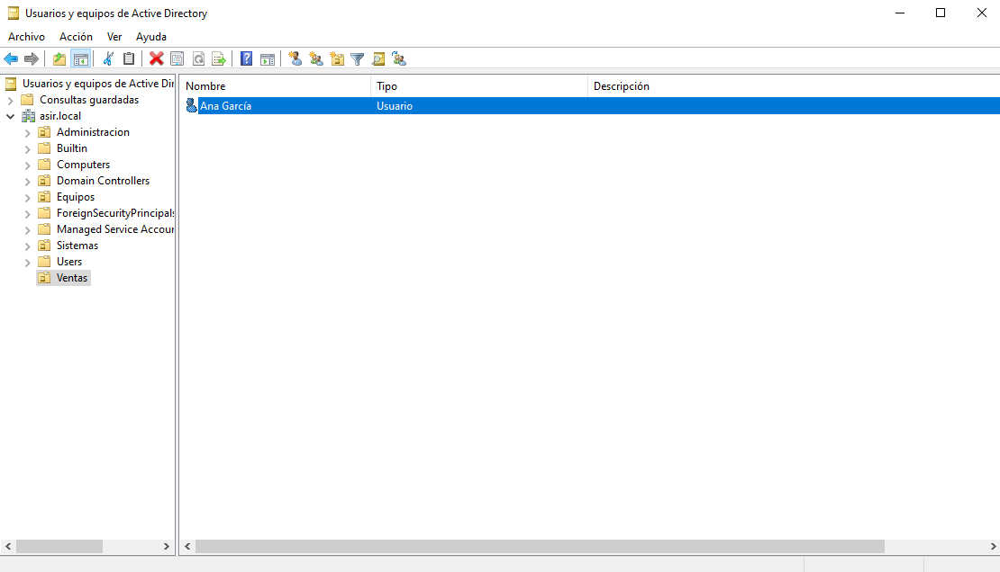

## Un usuario olvidó su contraseña. ¿Podemos reestablecerla?

¡Por supuesto! Para reestablecer la contraseña de cualquier usuario, haremos “click” derecho sobre su nombre y pulsaremos en **Reestablecer contraseña**:

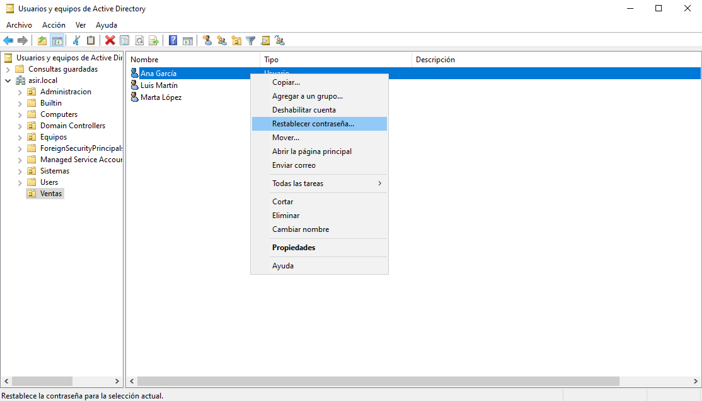

En la ventana que se nos abra, pondremos una contraseña y dejaremos marcada la opción que viene por defecto **El usuario debe cambiar la contraseña en el siguiente inicio de sesión** para que ponga otra que recuerde mejor:

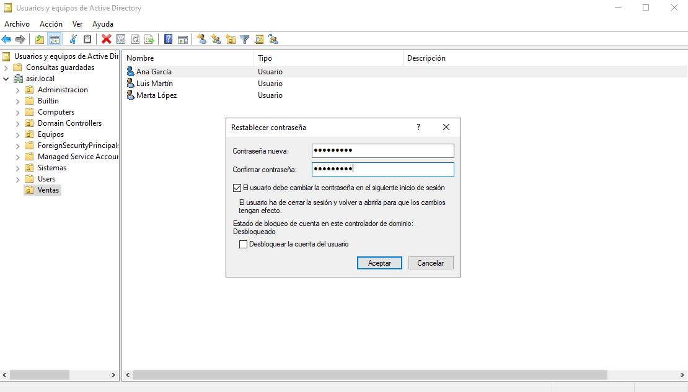

## ¿Se puede limitar a qué horas puede conectarse un usuario?

Sí. Si queremos que un usuario pueda conectarse solo durante su horario de jornada laboral, haremos “click” derecho sobre el usuario y en el desplegable seleccionaremos **Propiedades**:

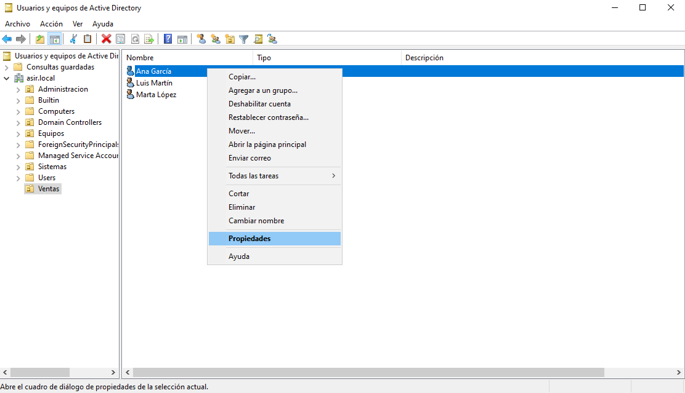

Se nos abrirá una ventana e iremos a la pestaña **Cuenta** y a continuación pulsaremos sobre el botón **Horas de inicio de sesión**:

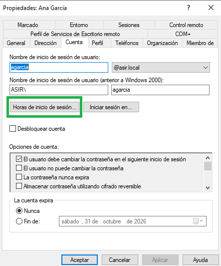

Y ahora seleccionaremos las horas que queramos que el usuario pueda iniciar sesión.
Para este ejemplo he dejado seleccionados los rectángulos azules para que el usuario pueda iniciar sesión de 7:00 de la mañana a 17:00 de la tarde, y no pueda conectarse durante el fin de semana:

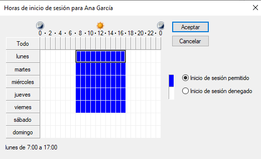

## ¿Puedo limitar desde qué ordenadores se conecta un usuario?

Sí. Para ello vamos a **Propiedades** del usuario que queramos y hacemos “click” en **Iniciar sesión en**:

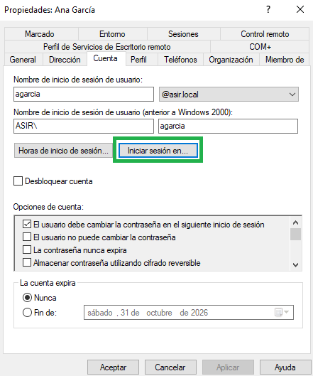

