# Cómo crear un Active Directory con Samba, OU, grupos y usuarios

>Samba es un conjunto de herramientas de software libre con el que podremos crear un dominio compatible con Active Directory utilizando un servidor Linux.

Primero comprobaremos que no tenemos instalado Samba en nuestro Ubuntu Server, usando el comando `sudo systemctl status samba-ad-dc`:

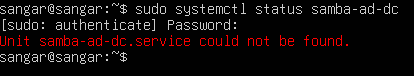

Para instalarlo, usaremos `sudo apt install samba-ad-dc` y volveremos a comprobar si se ha instalado correctamente usando de nuevo `sudo systemctl status samba-ad-dc`:

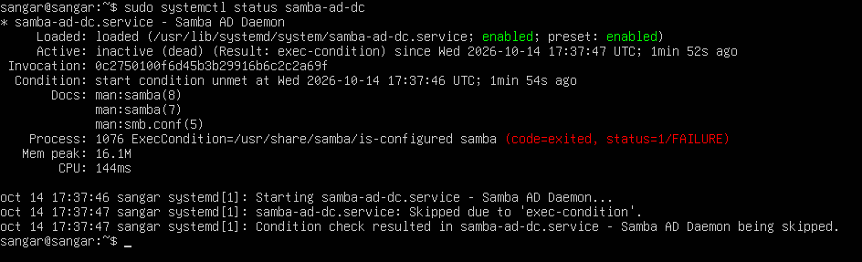

Antes de continuar, vamos a asignar una IP fija a Ubuntu Server. Para ello vamos a usar el comando `sudo ls /etc/netplan/` y en dicho directorio debería haber un fichero .yaml

Usaremos el comando `sudo nano /etc/netplan/00-cloud.init.yaml` y lo modificaremos para que quede de la siguiente forma:

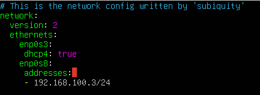

Lo guardaremos y usaremos los siguientes comandos para que se queden guardados los cambios realizados:

`sudo netplan generate`
`sudo netplan apply`

Comprobaremos que se han efectuado los cambios:

`ip -br addr`

Y veremos algo como esto:

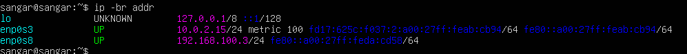

A continuación, vamos a cambiar el nombre del equipo. Si usamos el comando `hostname -f` veremos el nombre actual. Para cambiarlo, usaremos `sudo hostnamectl set-hostname DC-LINUX01`. Volvemos a poner `hostname -f` para comprobar que realmente se ha cambiado el nombre del equipo:

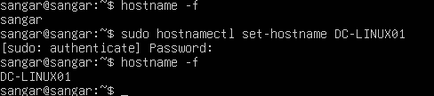

Si usamos el comando `exit` nos desloguearemos y vovemos a iniciar sesión, veremos que el nombre del equipo del dominio ha cambiado:

El siguiente paso es modificar el registro DNS para que se reconozca nuestro equipo. Para ello, vamos a usar `sudo nano /etc/hosts` y veremos algo como esto:

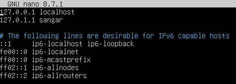

Modificaremos la segunda línea y le pondremos: **192.168.100.3 dc-linux01.asir.local dc-linux01**.

Hemos asignado dos nombres **dc-linux01.asir.local** que es el nombre del dominio que le vamos a poner, y **dc-linux01** que es el nombre del equipo que ya le hemos puesto.

El fichero quedaría de la siguiente manera:

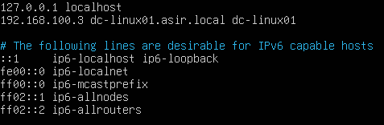

Ahora vamos a instalar el directorio activo usando Samba, Kerberos y Bind9, por medio del comando `sudo apt install samba-ad-dc krb5-user bind9-dnsutils`

>Kerberos 5 es un protocolo de autenticación para verificar de forma segura la identidad de usuarios y servicios sin enviar la contraseña por la red.

>Bind9 es un servidor DNS que traduce nombres de dominio en direcciones IP y permite localizar servicios de red.

Tras usar ese comando y poner "s" nos aparecerá esta ventana:

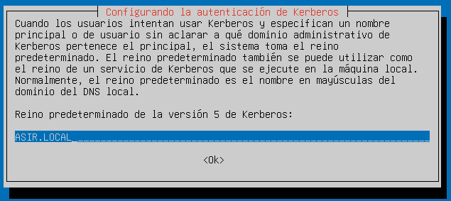

En caso de salir algún error previo a esa imagen, deberemos actualizar con `sudo upgrade`

Ahora nos aparecerá otra ventana en la que tendremos que especificar nuestro servidor, que en ese caso es **dc-linux01.asir.local**

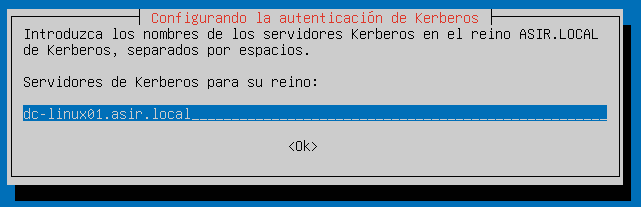

Como servidor administrativo pondremos lo mismo: **dc-linux01.asir.local**:

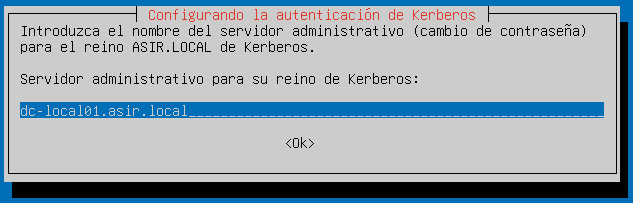

Con esto finalizaría la instalación de Samba. Lo podemos comprobar usando `samba --version` y nos devolverá:

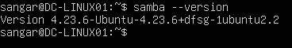

En el directorio `/etc/samba/` debería haberse creado un directorio. Lo comprobamos con `sudo ls /etc/samba/`

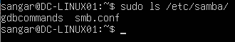

Aparecen unos ficheros. Vamos a renombrar uno en concreto que se llama **smb.conf**

Para hacer esto, usaremos el comando `sudo mv /etc/samba/smb.conf /etc/samba/smb.conf.original`

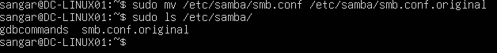

Ahora vamos a promocionar el dominio a controlador de dominio, con el comando `sudo samba-tool domain provision --use-rfc2307 --realm=ASIR.LOCAL --domain=ASIR --server-rol=dc --dns-backend=SAMBA_INTERNAL`

Cuando finalice este proceso, volveremos a revisar el directorio `/etc/samba` usando el comando `sudo ls -la /etc/samba` y veremos que se nos ha creado un fichero llamado **smb.conf** y que tenemos el que habíamos renombrado antes **smb.conf.original**:

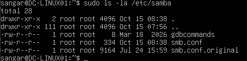

También se los habrá creado un fichero llamado **krb5.conf** en `/etc/krb5.conf`

A continuación, vamos a comprobar el estado de samba, por medio del comando `sudo systemctl status samba-ad-dc`:

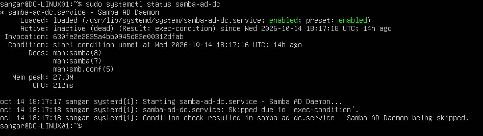

Observamos que samba está habilitado pero inactivo. Lo podemos activar usando `sudo systemctl restart samba-ad-dc` y luego comprobaremos su estatus con `sudo systemctl status samba-ad-dc`:

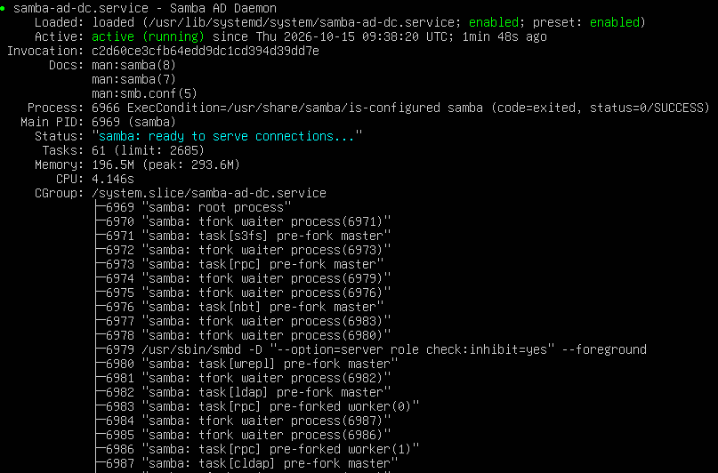

En caso de que saliera algún error, usaremos el comando `sudo systemctl disable --now smbd nmbd winbind` para evitar que los servicios tradicionales de samba compitan con el controlador de dominio integrado. Esto no borra ni modifica la base de datos del dominio.

Una vez hecho eso, volveremos a usar los comandos `sudo systemctl restart samba-ad-dc` y `sudo systemctl status samba-ad-dc` para que esté habilitado y activo samba.

Los puertos usado para DNS, Kerberos, LDAP y SMB son:

* DNS: 53
* Kerberos: 88
* LDAP: 389
* SMB: 445

Sabiendo esto, podemos usar el siguiente comando para comprobar si se están usando dichos puertos `sudo ss -lntup | grep -E '(:53|:88|:389|:445)'`

Para comprobar información de nuestro dominio con samba-tools usaremos `sudo samba-tool domain info 127.0.0.1`:

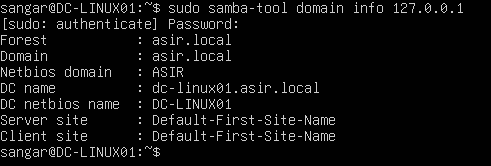

Ahora vamos a configurar el DNS para que el active directory reconozca los equipos que tiene conectados a él.

Si tras hacer `sudo systemctl status samba-ad-dc` nos aparecen estas líneas en rojo:

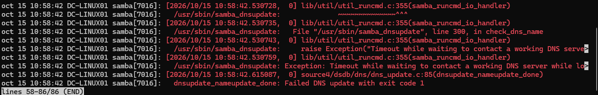

Significa que Samba no consigue contactar con un servidor DNS operativo para actualizar los registros de Active Directory.

Usaremos el comando `ls -l /etc/resolv.conf` y comprobaremos que apunta a `/run/systemd/resolve/stub-resolv.conf`.

De ser así, usaremos `sudo unlink /etc/resolv.conf` para desligarlo. Luego abriremos el fichero con `sudo nano /etc/resolv.conf` y le añadiremos las siguientes dos líneas:

`nameserver 192.168.100.3`

`search asir.local`

Usaremos el comando `dig @192.168.100.3 dc-linux01.asir.local` y si el DNS está bien configurado, deberíamos ver algo como esto:

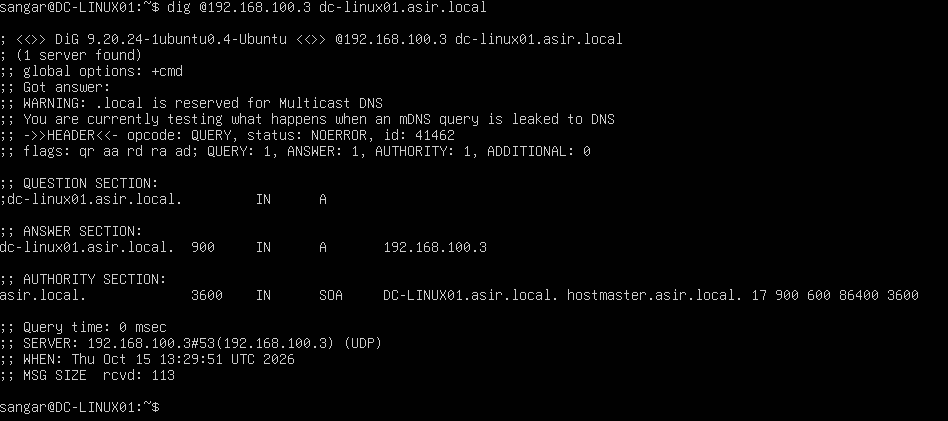

Ahora vamos a ver qué usuarios tiene el Active Directory, usando el comando `sudo samba-tool user list`:

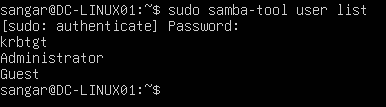

Donde:

* krbtgt --> Usuario para Kerberos
* Administrator --> Usuario Administrador
* Guest --> Usuario invitado

Si queremos crear un nuevo usuario, usaremos `sudo samba-tool user create alumno`

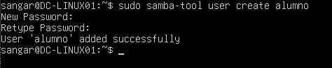

Con dicho comando hemos creado un usuario llamado "alumno" y le hemos establecido una contraseña.

Para ver información del usuario escribiremos `sudo samba-tool user show alumno`

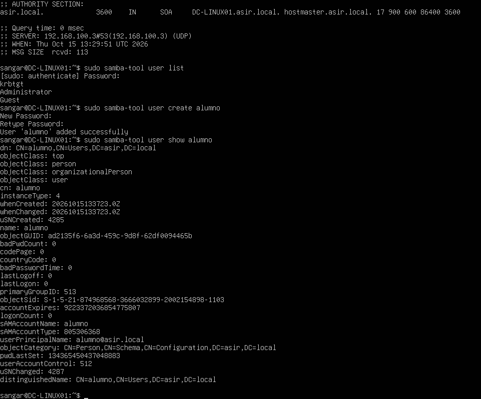

Para crear unidades organizativas (OU) usaremos el comando `sudo samba-tool ou create "OU=Alumnos,DC=ASIR,DC=local"`

Y para lista unidades organizativas `sudo samba-tool ou list`

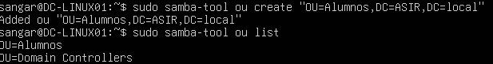

Para mover el usuario "alumno" a la unidad organizativa usaremos `sudo samba-tool user move alumno "OU=Alumnos,DC=ASIR,DC=local"`

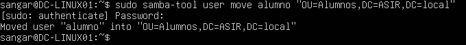

Si queremos crear un grupo, escribiremos `sudo samba-tool group add AlumnosASIR`

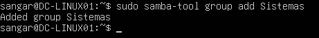

Para ver los grupos creados, usaremos `sudo samba-tool group list`. En esta lista aparecen grupos ya predefinidos, además de los que hayamos creado nosotros:

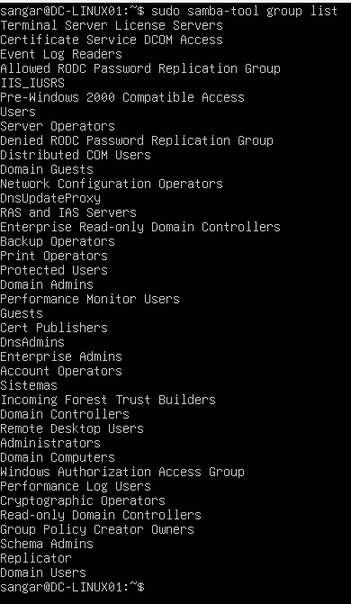

Si queremos añadir un usuario a un grupo, pondremos `sudo samba-tool group addmembers Sistemas alumno`

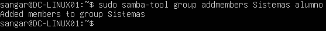

Y para ver todos los miembros que hay en un grupo: `sudo samba-tool group listmembers Sistemas`

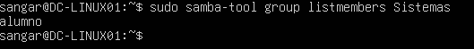

Si usamos el siguiente comando: `sudo nano /etc/samba/smb.conf`

Se nos abrirá el fichero `smb.conf` al cuál añadiremos la línea para indicar a Samba en qué interfaces de red debe escuchar y prestar sus servicios:

>interfaces = lo enp0s8

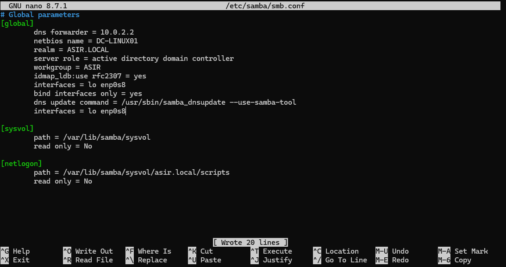

Comprobaremos que la configuración es correcta con `sudo testparm`, nos pedirá pulsar "ENTER" y veremos esto:

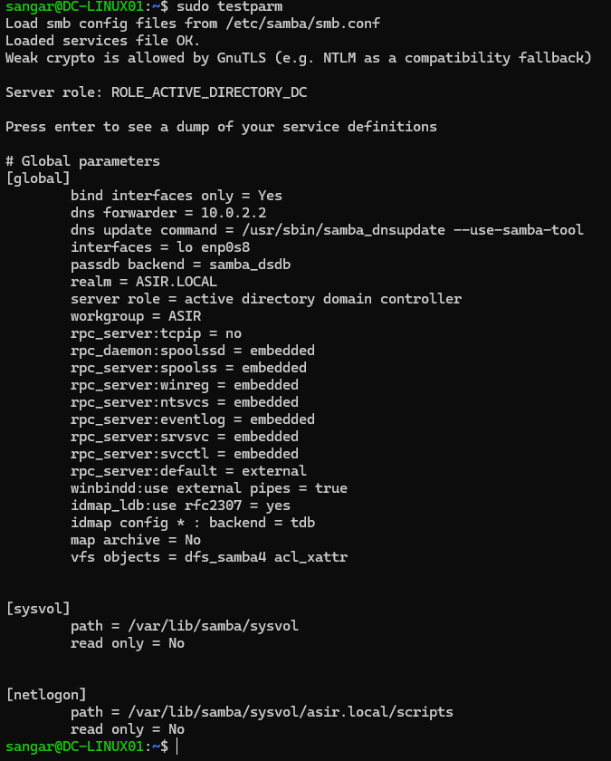

Reiniciamos el servicio: `sudo systemctl restart samba-ad-dc` y luego `sudo systemctl status samba-ad-dc`

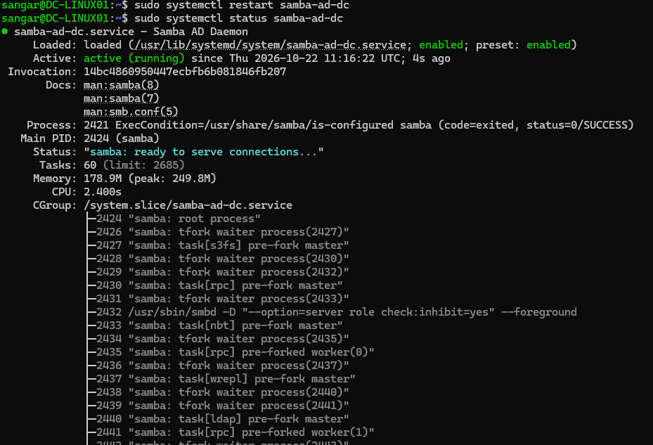