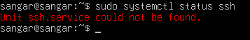
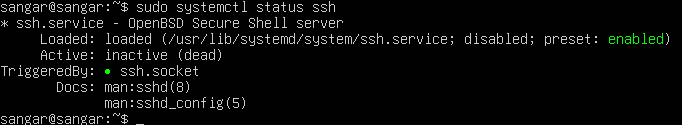
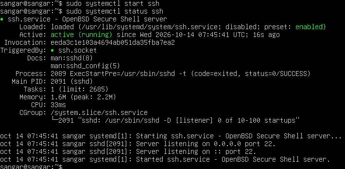
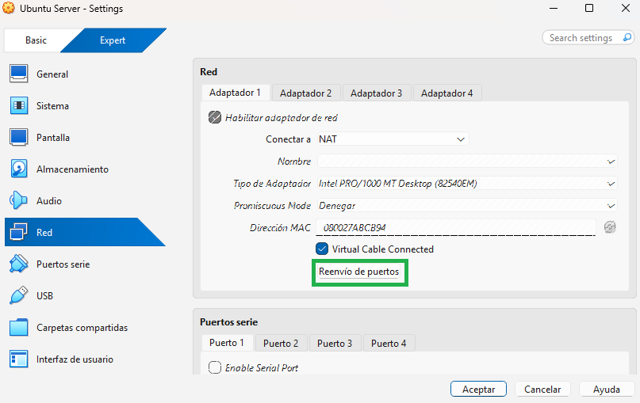
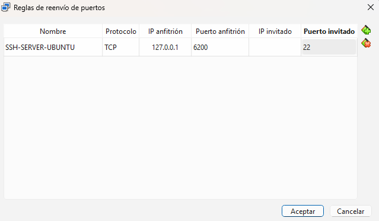
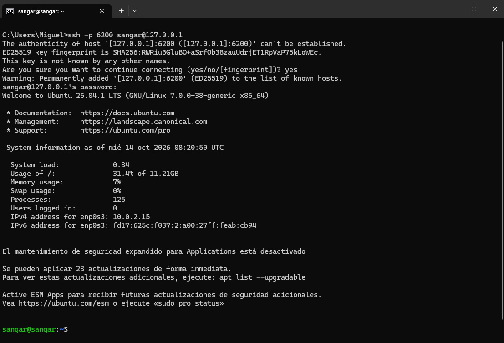

# CÓMO ESTABLECER CONEXIÓN SSH

En Ubuntu Server usaremos el comando `sudo systemctl status ssh` para comprobar si ssh está habilitado:

Observamos que ssh no está instalado. Para instalarlo, usaremos el comando `sudo apt install openssh-server`.
Empezará a descargarse los paquetes, y tras finalizar la instalación, volveremos a ejecutar `sudo systemctl status ssh`:

Ahora ya está habilitado, pero inactivo. Para activarlo, usaremos el comando `sudo systemctl start ssh`:

A continuación, vamos a la configuración de nuestra máquina virtual de VirtualBox, en la sección Red -> Adaptador 1 y hacemos "click" en el botón **Reenvío de puertos**:

Se nos abrirá una ventana y la configuraremos de la manera en que se ve a continuación:

En **IP anfitrión** hemos puesto **127.0.0.1** porque es la dirección loopback usada por defecto en nuestro equipo, y como **Puerto anfitrión** ponemos 6200 porque es un puerto que está libre. Esto quiere decir que nuestro equipo usará el puerto 6200 para conectarse al puerto 22 del Ubuntu Server de la máquina virtual cada vez que queramos establecer conexión remota.

Finalmente, abrimos un CMD desde nuestro equipo y usamos el siguiente comando para conectarnos a la máquina virtual usando ssh: `ssh -p 6200 sangar@127.0.0.1`:

