# Cómo unir un cliente Linux a un Active Directory de Ubuntu Server

## PASO 1: Preparación del cliente

Para esta práctica necesitaremos:

* Ubuntu server con 2 adaptadores de red: NAT y red interna, donde tenemos que tener ya instalado un Active Directory con un dominio.
* Una distribución Linux que queramos, que será nuestro cliente (yo usaré Debian) con un adaptador de red interna.

Antes de continuar, **vamos a realizar una serie de instalaciones de paquetes en nuestro cliente**, previos a los pasos a realizar:

* `sudo apt update`
* `sudo apt upgrade -y`
* `sudo apt install realmd sssd-ad sssd-tools adcli`
* `sudo apt install systemd-resolved`
* `sudo apt install krb5-user`

Y usaremos `dpkg -l realmd sssd-ad sssd-tools adcli systemd-resolved krb5-user` para asegurarnos de que se han instalado. Si vemos "ii" al principio de cada línea, significa que se han instalado correctamente:

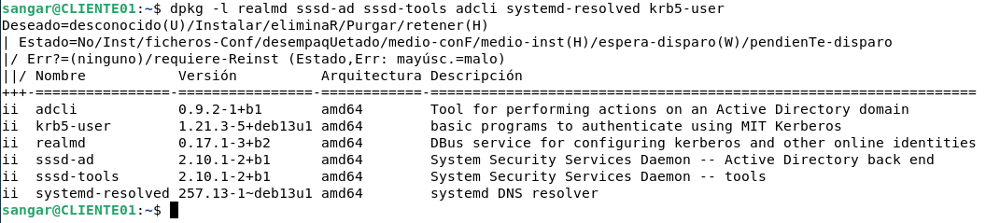

Ahora arrancaremos una distribución Linux con una configuración NAT (más tarde la cambiaremos a interna), comprobaremos el nombre de usuario y lo cambiaremos por "CLIENTE01":

`hostname`

`sudo hostnamectl set-hostname CLIENTE01`

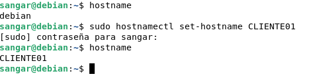

Cerramos la terminal y abrimos otra que nos muestre: **'usuario'@'nuevonombredelequipo'**

Paso a explicar la utilidad de cada herramienta del siguiente comando:

`sudo apt install realmd sssd-ad sssd-tools adcli`

* **Realmd**: Nos ayuda a descubrir y unir el equipo a dominio
* **SSSD**: Es el servicio que permitirá a Linux utilizar las identidades del dominio.
* **Adcli**: Realiza operaciones necesarias para registrar el equipo en Active Directory.
* **SSSD-tools**: Incluye herramientas para administrar y comprobar el servicio SSSD.

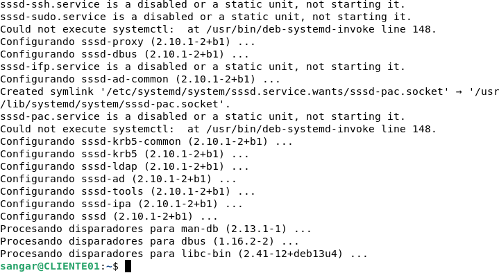

## PASO 2: Configuración de red y DNS

Ahora que ya hemos realizado las instalaciones básicas, cambiaremos el adaptador a "red interna". Al hacer eso, no tendremos conexión a internet. De hecho si hacemos `ping 8.8.8.8` o `ping www.google.es` no obtendremos respuesta:

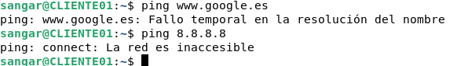

¿Cómo solucionamos esto? Asignando una IP fija. Para lograrlo, iremos al escritorio de nuestra distribución, y observaremos el icono de "conexiones" que hay en la parte superior derecha y haremos click de forma ordenada en las zonas que muestro en la siguiente imagen:

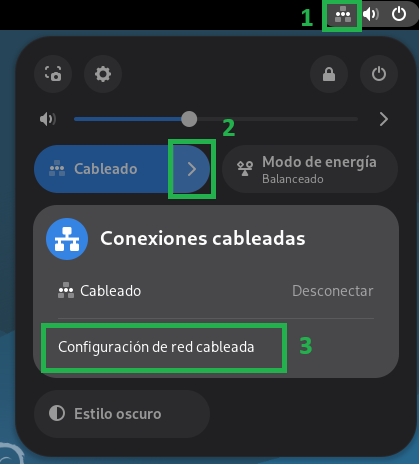

Se abrirá una ventana y haremos "click" en el icono del engranaje:

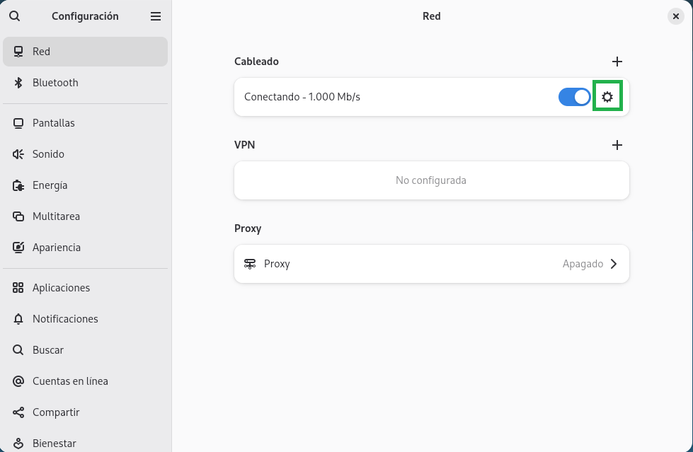

Se abrirá la siguiente ventana, que configuraremos de la siguiente forma:

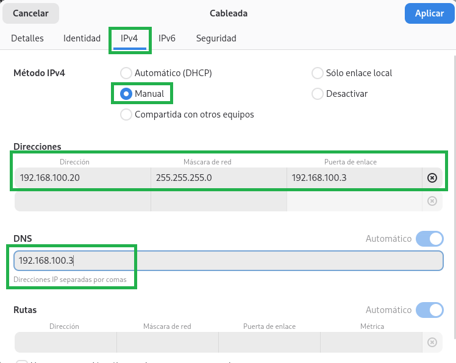

Le asignamos la dirección IP que queramos, pero que esté dentro de la red de la misma red de Ubuntu Server, que es a la que nos queremos conectar. En mi caso he puesto 192.168.100.20

Máscara de subred: 255.255.255.0

La puerta de enlace hay que poner la IP que tenga Ubuntu Server, que en mi caso tiene 192.168.100.3

Como DNS usaremos también la IP de Ubuntu Server.

Aplicamos cambios y cerramos la ventana que aparezca.

Si volvemos a hacer `ping 8.8.8.8` NO devolverá paquetes, pero si hacemos `ping 192.168.100.3` comprobaremos que SÍ recibimos paquetes.

Así que tenemos que resolver el problema de DNS, y lo haremos de la siguiente manera:

Si hacemos un `ip a` nos devuelve:

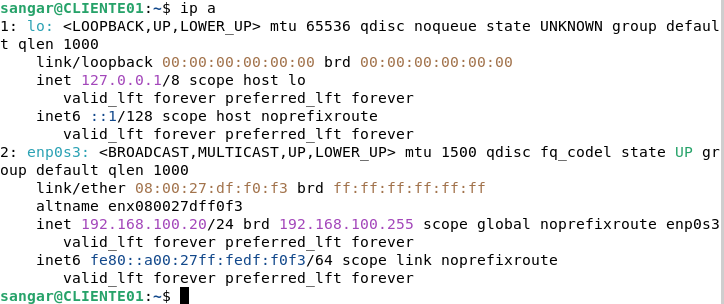

Observamos que tenemos la interfaz "lo" que es la de loopback y la interfaz "enp0s3" que es la que usaremos para comunicarnos con Ubuntu Server.

Estableceremos el adaptador de red de VirtualBox a red interna para poder comunicarnos con el servidor. Para ello, escribiremos el siguiente comando en la terminal de nuestra máquina cliente (Debian, en mi caso):

`sudo resolvectl domain enp0s3 '~asir.local'`

Si nos devuelve "resolvectl: command not found" significa que "resolvectl" no está instalado y tendremos que volvernos a conectar a NAT, dejar DHCP en vez de manual, y usar `sudo apt install systemd-resolved` para instalarlo.

Si al usar el comando `sudo resolvectl domain enp0s3 '~asir.local'` nos devuelve algún error, usaremos `sudo systemctl restart systemd-resolved` para reiniciarlo, y luego `resolvectl status` para comprobar si está arrancado.

Al volver a hacer `resolvectl status` nos debería devolver algo como esto:

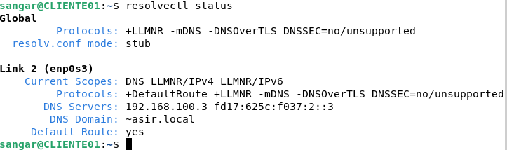

Si hacemos `ip a` veremos que la interfaz "enp0s3" que muestra la ip que le hemos asignado (192.168.100.20):

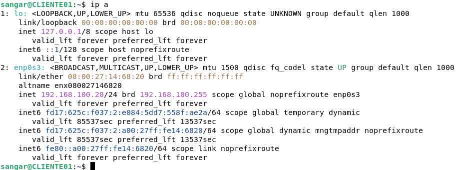

Y si hacemos `ping -c 4 192.168.100.3` nos devolverá OK:

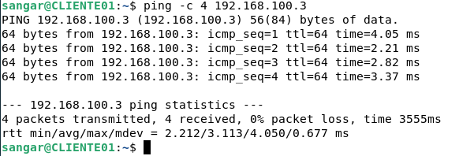

Pero si hacemos `ping -c 4 dc-linux01.asir.local` recibiremos un error:

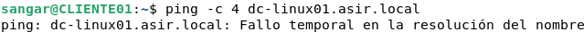

Este error es debido a una configuración errónea de DNS. De hecho, al hacer `resolvectl status` hemos visto que no nos muestra la línea "DNS domain: ~asir.local"

Reiniciamos la conexión:

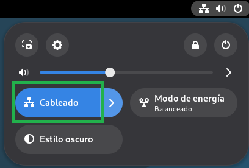

Volvemos a hacer:

`sudo resolvectl domain enp0s3 '~asir.local'`

`resolvectl status`

`ping -c 4 dc-linux01.asir.local`

Y veremos que ya aparece la línea "**DNS Domain: ~asir.local**" y además ya deberíamos poder hacer ping al directorio activo a través de la interfaz de red enp0s3:

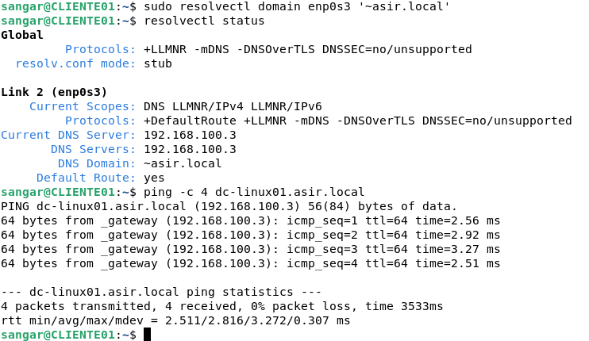

Desde el propio servidor, vamos a consultar en el DNS qué servidor ofrece el servicio LDAP dentro del dominio, por medio de:

`dig SRV _ldap._tcp.asir.local`

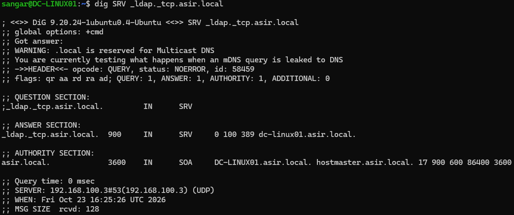

## PASO 3: Kerberos y descubrimiento

Ahora vamos a consultar en el DNS qué servidor ofrece el servicio Kerberos para el dominio "asir.local":

`dig SRV _kerberos._tcp.asir.local`

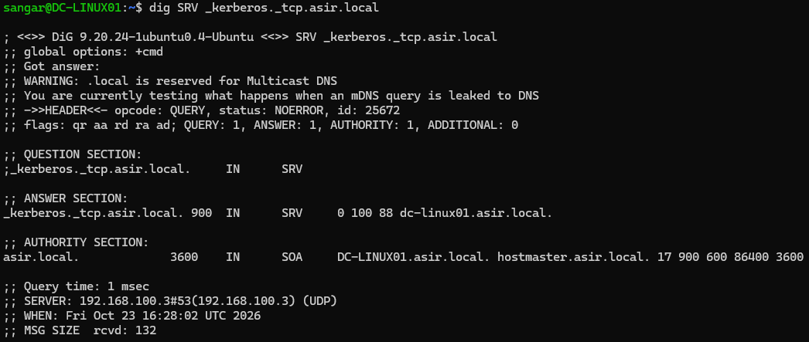

Otra cosa que debemos comprobar es la hora, ya que Kerberos utiliza tickets con una validez temporal. Si la hora del cliente y del servidor está demasiado desfasada, la autenticación puede fallar.

Vamos a usar el siguiente comando tanto en el servidor como en el cliente para ver si hay desfase:

`timedatectl`

Esto es lo que me devuelve en Ubuntu Server:

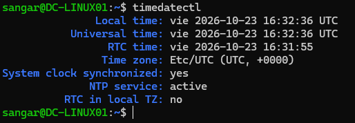

Y esto lo que me devuelve en Debian:

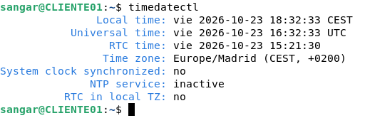

La siguiente comprobación será detectar desde nuestro cliente Debian, nuestro dominio "asir.local" y obtener información sobre él:

`realm discover asir.local`

Si no tuviéramos instalado "realm" probaremos el siguiente comando, que incluye la ruta donde está instalado:

`sudo /usr/sbin/realm discover asir.local`

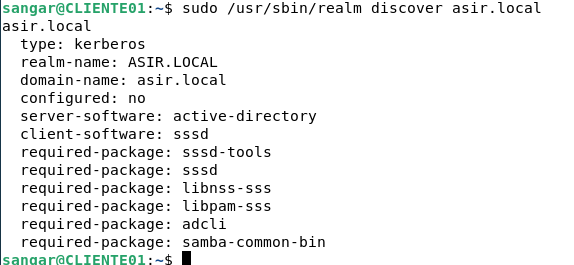

## PASO 4: Unión al dominio

Ahora vamos a crear una nueva cuenta de equipo desde nuestro servidor, para unir nuestro cliente Debian al domino "asir.local".

Para ello, escribiremos:

`sudo samba-tool computer create CLIENTE01`

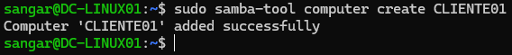

Comprobamos las computadoras de equipo registradas:

`sudo samba-tool computer list`

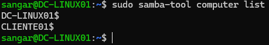

Comprobaremos la configuración de Kerberos desde el cliente:

`sudo nano /etc/krb5.conf`

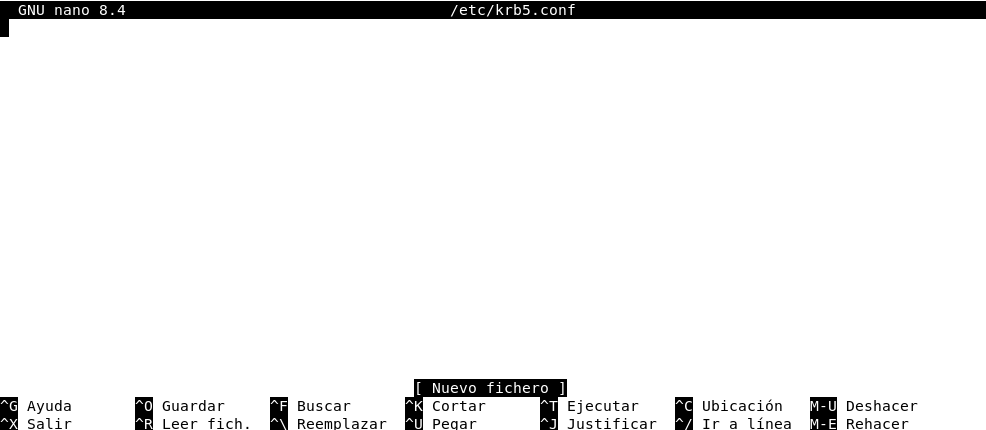

Dicho fichero podría estar vacío, y tendremos que añadir lo siguiente:

```
[libdefaults]
    default_realm = ASIR.LOCAL
    dns_lookup_realm = false
    dns_lookup_kdc = true
```

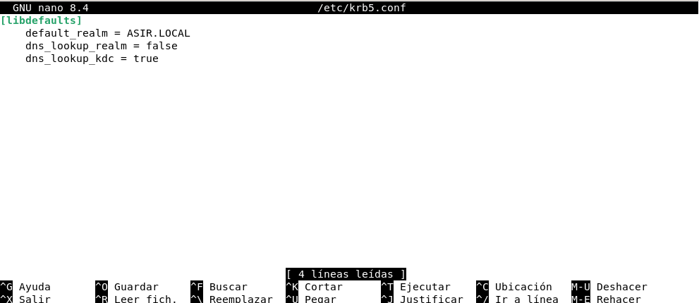

Desde el cliente, modificaremos el archivo **/etc/hosts** de nuestro server para garantizar que el cliente sepa quién es él mismo dentro del dominio "asir.local" y sepa encontrar exactamente al Controlador de Dominio. Para ello, escribiremos el comando:

`sudo nano /etc/hosts`

Y escribiremos lo siguiente:

```
127.0.0.1 localhost
127.0.0.1 CLIENTE01.asir.local CLIENTE01
192.168.100.3 dc-linux01.asir.local dc-linux01
```

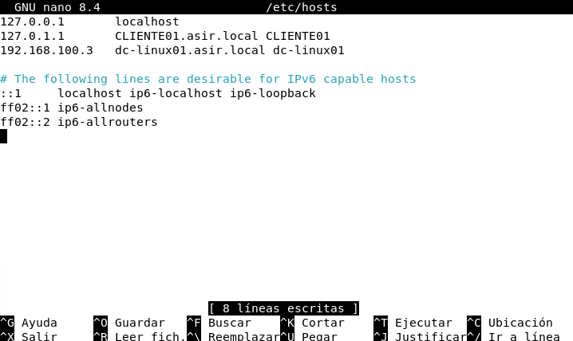

Una vez hagamos esto, iremos a nuestro servidor para unir el cliente Debian a dominio:

`sudo realm join --user=Administrator asir.local`

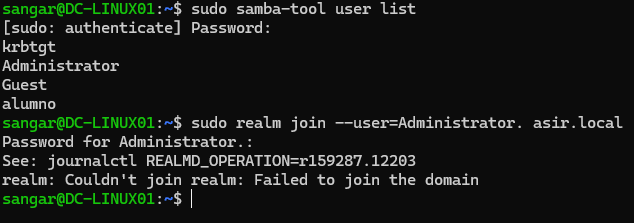

Si nos sale un mensaje de error similar, indicando que no se ha podido unir el cliente a dominio, tal vez sea porque no hemos establecido una contraseña para "Administrator". La setearemos por medio del comando:

`sudo samba-tool user setpassword Administrator`

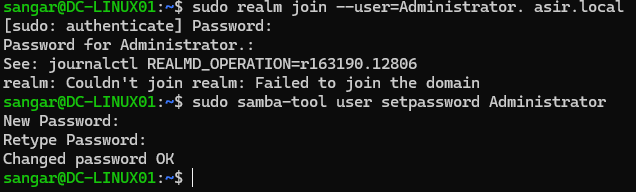

Volvemos a intentar usar el comando, y esta vez debería dejarnos unir el cliente al server:

`sudo realm join --user=Administrator asir.local`

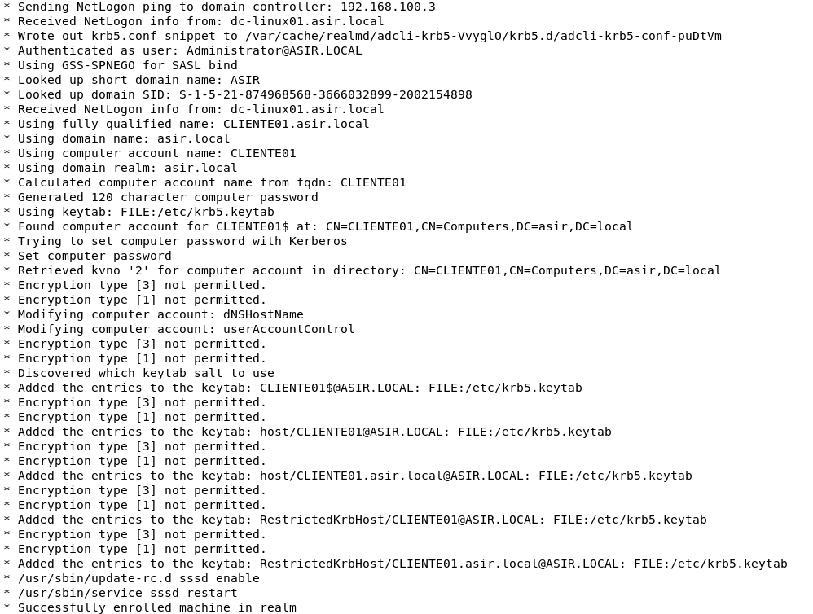

Para confirmar si el cliente está unido al server, usaremos:

`/usr/sbin/realm list`

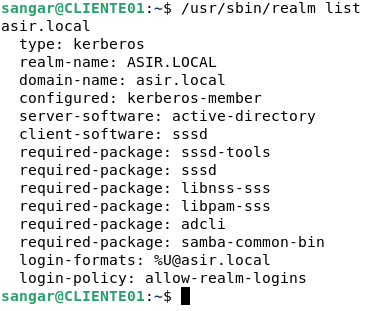

Para permitir que el cliente pueda crear un directorio personal cuando entre por primera vez un usuario de un dominio:

`sudo pam-auth-update --enable mkhomedir`

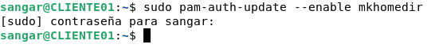

## PASO 5: Inicio de sesión y pruebas finales

Por último, vamos a cerrar sesión del cliente:

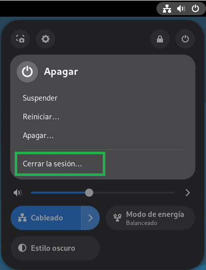

En la pantalla de inicio de sesión, pulsaremos en "¿No está en la lista?":

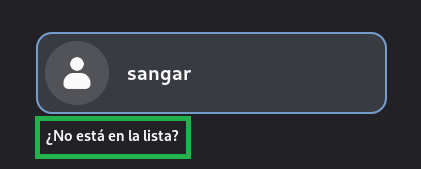

Nos pedirá introducir un usuario existente en el servidor:


Si no recordamos qué usuarios existen, abriremos una terminal desde nuestro servidor y escribiremos el comando `sudo samba-tool user list`:

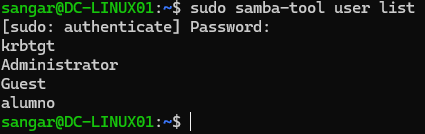

Y pondremos "alumno@asir.local" y la contraseña del usuario "alumno".

En caso de no recordar la contraseña de "alumno", abriremos una terminal del server y escribiremos el comando:

`sudo samba-tool user setpassword alumno`

Tras poner la contraseña e iniciar sesión, escribiremos en la terminal del cliente `whoami` para ver el nombre de usuario:

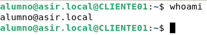

## PASOS OPCIONALES:

Para obtener el identificador del usuario y pertenencia a grupos y dominio, usaremos:

`id alumno@asir.local`

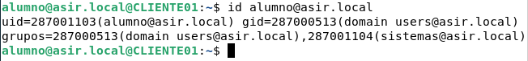

Y para comprobar la ficha de usuario:

`getent passwd alumno@asir.local`

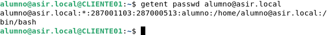

Para consultar las zonas horarias disponibles relacionadas con Madrid, ejecutaremos:

`timedatectl list-timezones | grep "Madrid"`

A continuación, estableceremos la zona horaria de Madrid mediante:

`timedatectl set-timezone Europe/Madrid`

Este comando permite que el sistema muestre la hora local correspondiente a Madrid, incluidos los cambios de horario estacional. Sin embargo, no sincroniza el reloj con ningún servidor horario.

Para comprobar el estado de la sincronización horaria, ejecutaremos:

`timedatectl`

En la salida, nos fijaremos en los campos System clock synchronized y NTP service.

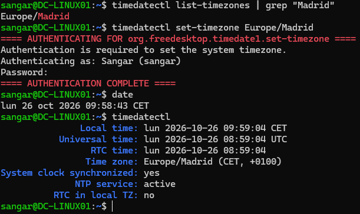

Esta comprobación es importante porque Kerberos, utilizado por Active Directory para la autenticación, puede rechazar solicitudes cuando existe una diferencia horaria excesiva entre el cliente y el controlador de dominio.