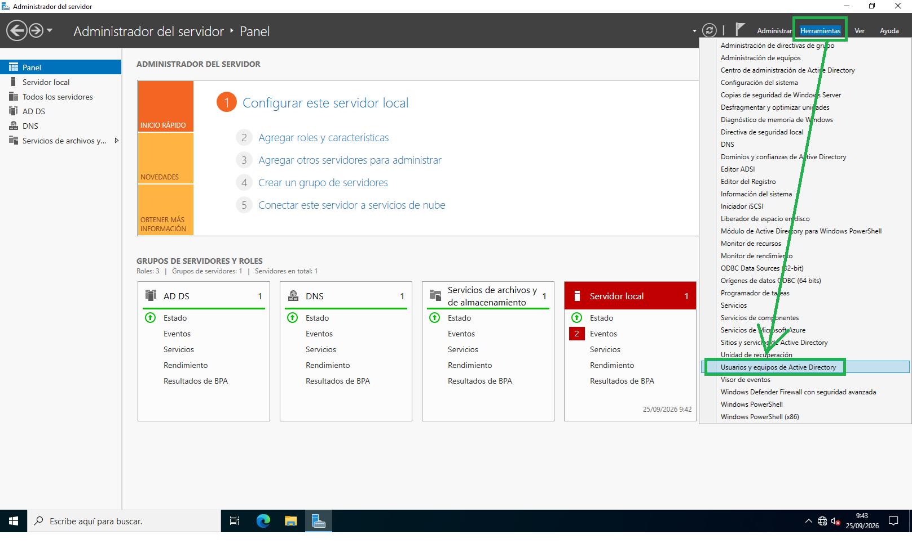
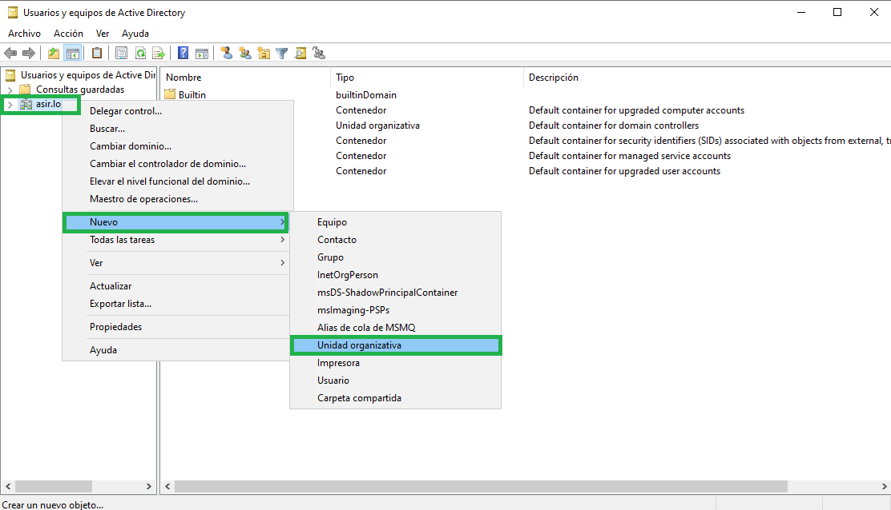
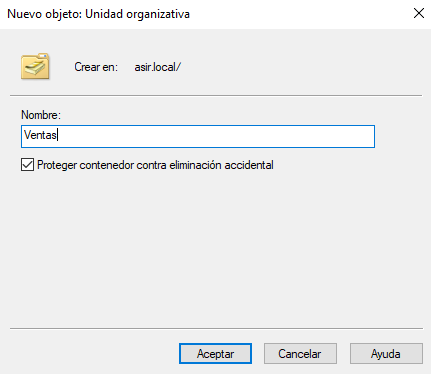
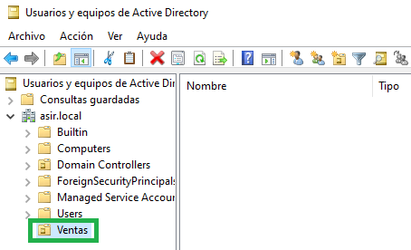

# 02 - Cómo crear una Unidad Organizativa (UO)
Podemos crear una Unidad Organizativa para cada departamento de la empresa, y dentro de la cuál crear grupos y usuarios para asignarles determinados privilegios.

Para crear una Unidad Organizativa (OU), iremos al administrador del servidor, después haremos click en **Herramientas** y en el desplegable seleccionaremos **Usuarios y equipos de Active Directory**:

Nos aparecerá una ventana y haremos click derecho sobre nuestro nombre de dominio.
Seleccionaremos **Nuevo** y a continuación **Unidad organizativa**.

A continuación, establereremos el nombre que queramos de la nueva unidad organizativa, por ejemplo “Ventas”:

Podemos comprobar que se ha creado un icono con la nueva Unidad Organizativa:

