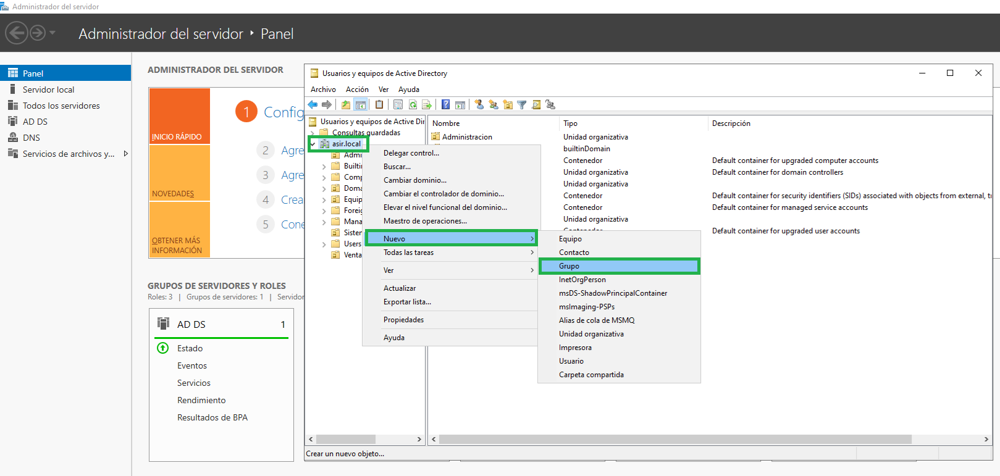
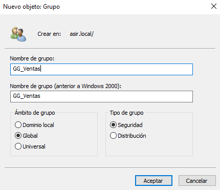
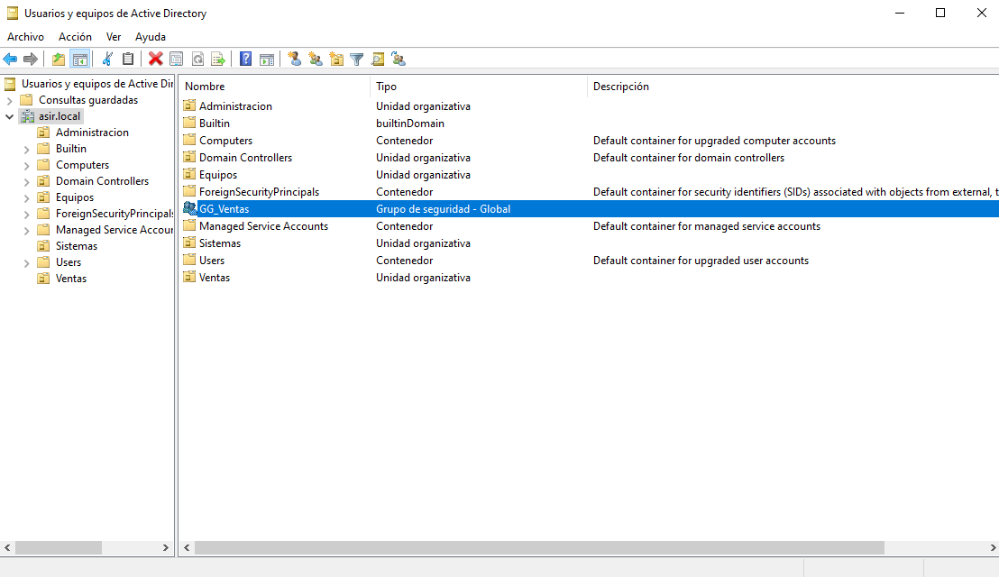
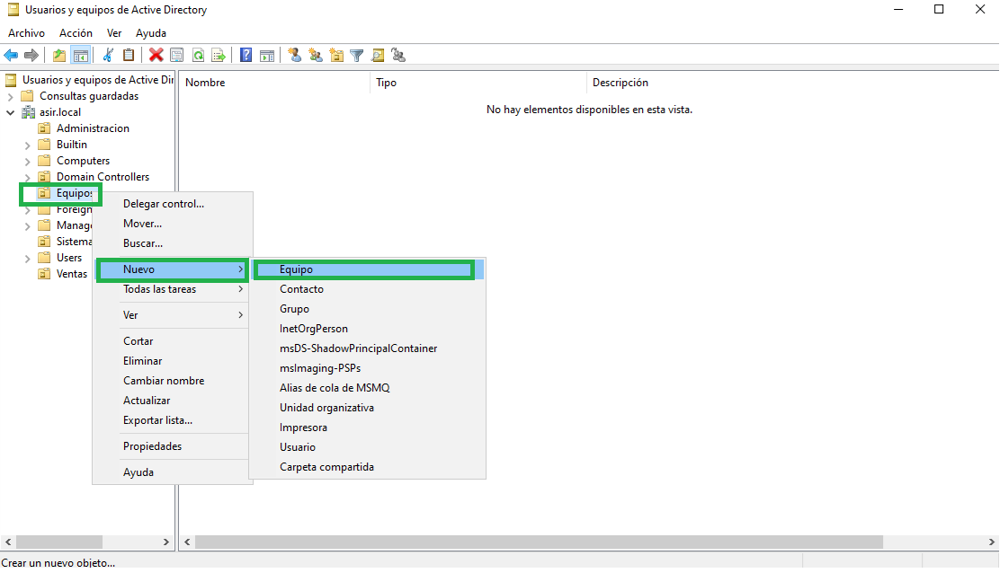
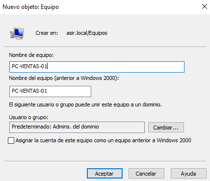

# 03 - Cómo crear grupos y equipos

## ¿CÓMO CREAMOS GRUPOS?

Para este tutorial, vamos a crear una serie de grupos fuera de las unidades organizativas.
(Más tarde podremos mover dichos grupos a la OU que queramos).

Primero haremos “click” derecho sobre nuestro dominio, que en mi caso es asir.local y en el desplegable seleccionaremos **Nuevo** → **Grupo**:

Se nos abrirá la siguiente ventana. Especificaremos el nombre de grupo que queramos y dejaremos marcadas las opciones que se muestran por defecto:

Tras pulsar en Aceptar veremos que ya tendremos el grupo creado:

## ¿CÓMO CREAMOS EQUIPOS?

Hacemos “click” derecho sobre **Equipos** → **Nuevo** → **Equipo**:

Se nos abrirá una ventana donde asignar un nombre al nuevo equipo:

