## 05 - Cómo tener varios controladores de dominio

Supongamos que disponemos de un controlador de dominio ubicado en Madrid y queremos implementar un segundo controlador de dominio en Barcelona, con el objetivo de mejorar la disponibilidad, aumentar la seguridad y disponer de una alternativa ante una posible caída de la red o del controlador de dominio de Madrid.

Para ello, será necesario añadir un nuevo controlador de dominio a nuestro entorno de Active Directory. De esta forma, ambos controladores podrán participar en la replicación de Active Directory, de manera que los cambios realizados en uno de ellos se repliquen automáticamente en el resto de controladores de dominio.

Además, cada controlador mantiene una copia de la base de datos de Active Directory (**ntds.dit**), lo que permite disponer de la información del directorio en ambos servidores y proporciona una mayor tolerancia ante posibles fallos.

Este es el esquema de lo que pretendemos hacer:

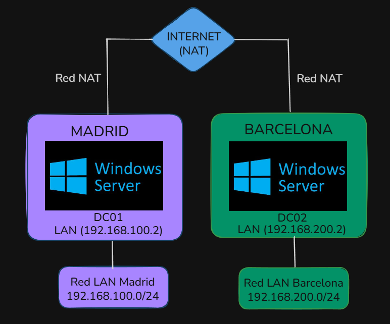

Lo primero que debemos hacer es ir a VirtualBox.
**Archivo** → **Herramientas** → **Red**

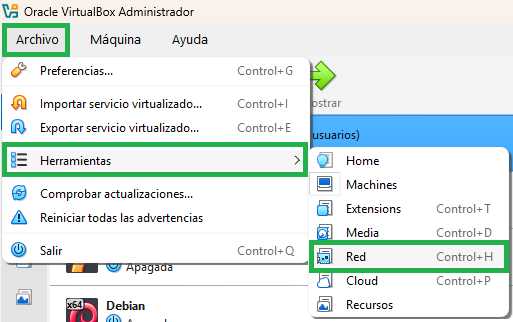

A continuación, dentro de la pestaña **Redes NAT**, le damos a **Crear** y establecemos un nombre para la red NAT:

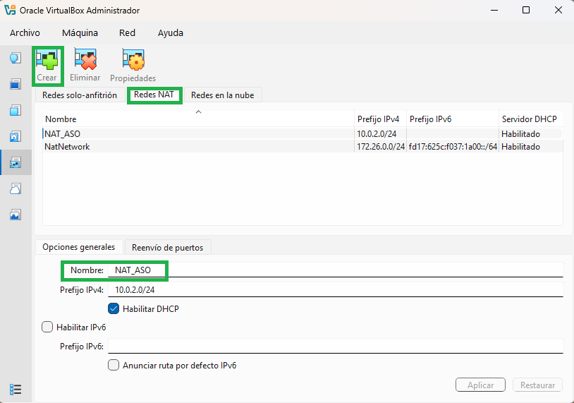

Configuraremos el servidor de Madrid de la siguiente manera:

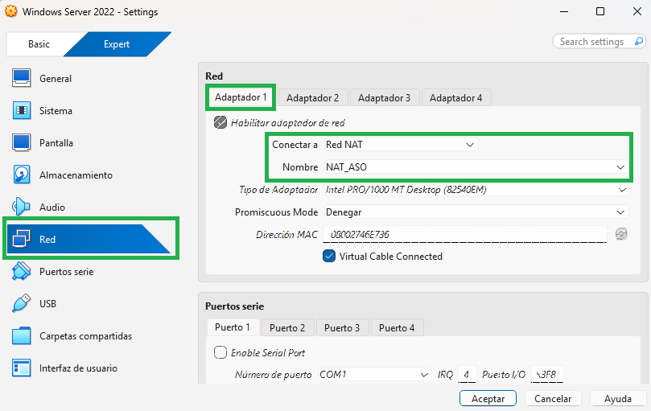

Ahora vamos al administrador del servidor del Active Directory de nuestro Windows y vamos a personalizarlo.

**Herramientas** → **Sitios y servicios de Active Directory**

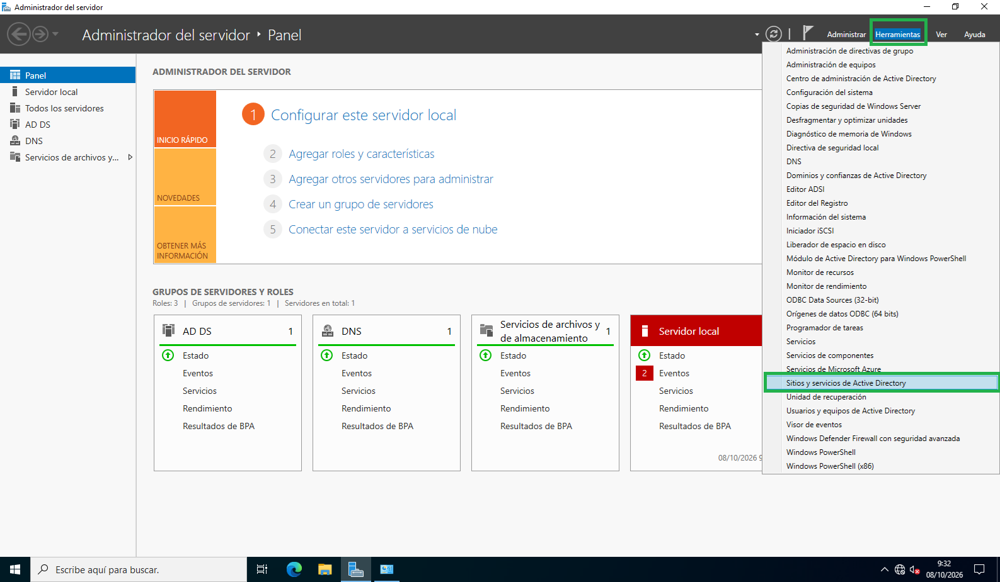

Se nos abrirá una ventana como esta, y le vamos a cambiar el nombre:

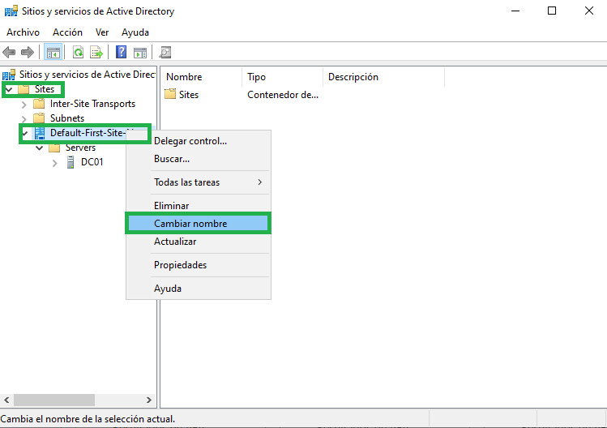

Nos debería quedar de esta manera:

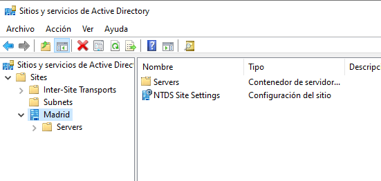

Ahora que hemos personalizado el controlador de dominio de Madrid, vamos a crear el de Barcelona:

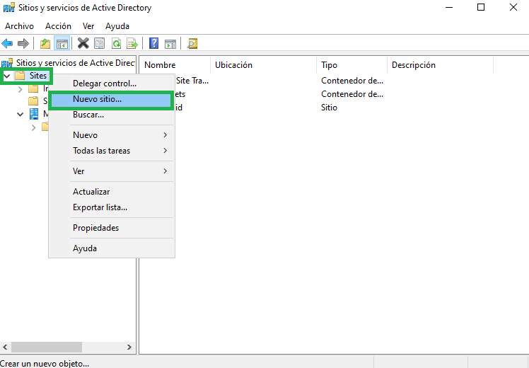

Pondremos de nombre “Barcelona” y seleccionaremos DEFAULTIPSITELINK:

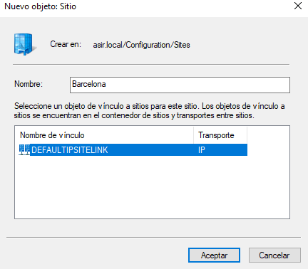

Nos aparecerá un mensaje de confirmación:

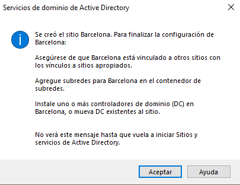

Y debería quedarnos así:

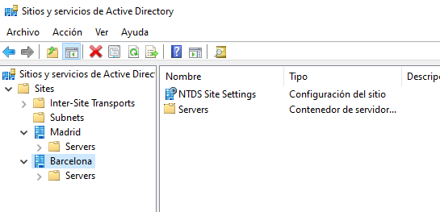

Ya tenemos los dos controladores de dominio creados. Ahora tenemos que asociarles redes.

**Subnets** → **Nueva subred**

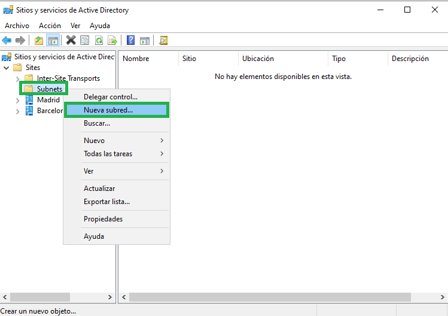

En **Prefijo** pondremos la red **192.168.100.0/24** y seleccionaremos **Madrid**:

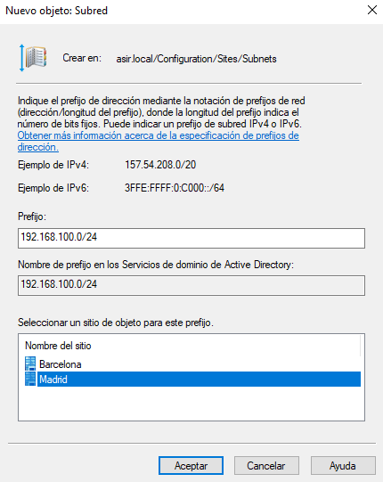

Tras aceptar, volveremos a hacer lo mismo, solo que esta vez en **Prefijo** pondremos **192.168.200.0/24** y seleccionaremos **Barcelona**:

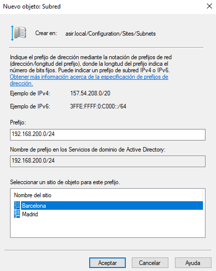

Nos debería quedar así:

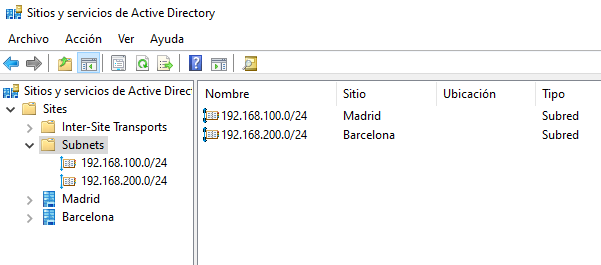

Con esto ya tendríamos configurado el servidor de Madrid.

Es importante que para que haya conectividad entre los servidores Madrid - Barcelona, configuremos la IP de ambos servers. Para ello, desde el server de Barcelona, abriremos un CMD y escribiremos el comando `ncpa.clp` y se nos abrirá la ventana de **Conexiones de red**.

”Click” derecho en **LAN** → **Propiedades**

Y seguiremos los pasos que se muestran en la imagen, poniendo como IP **192.168.200.2**

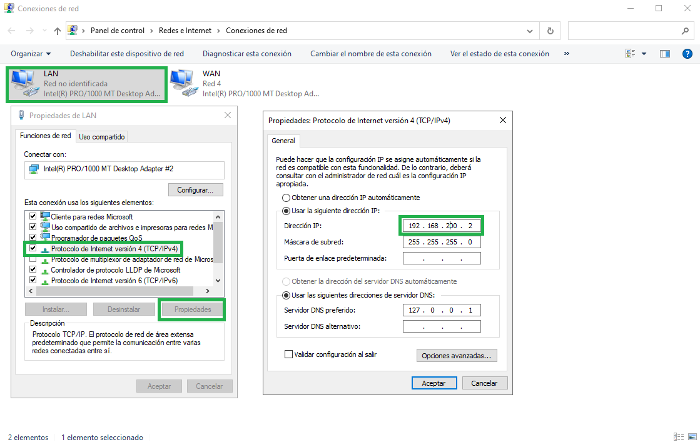