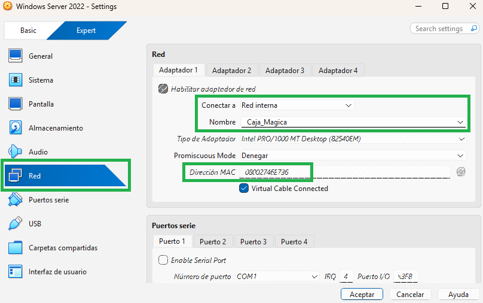
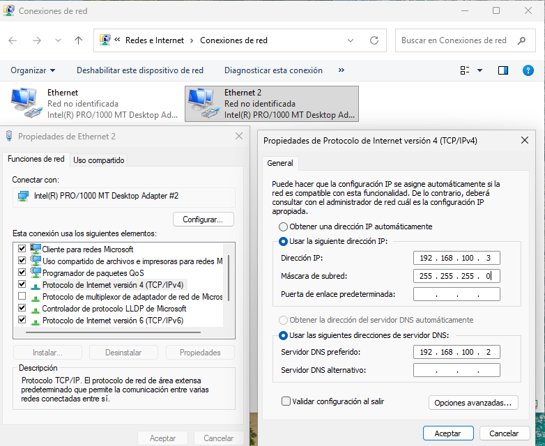
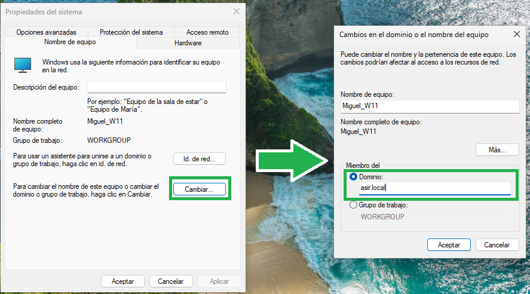
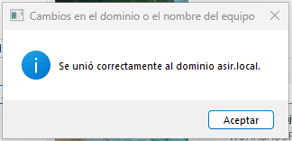
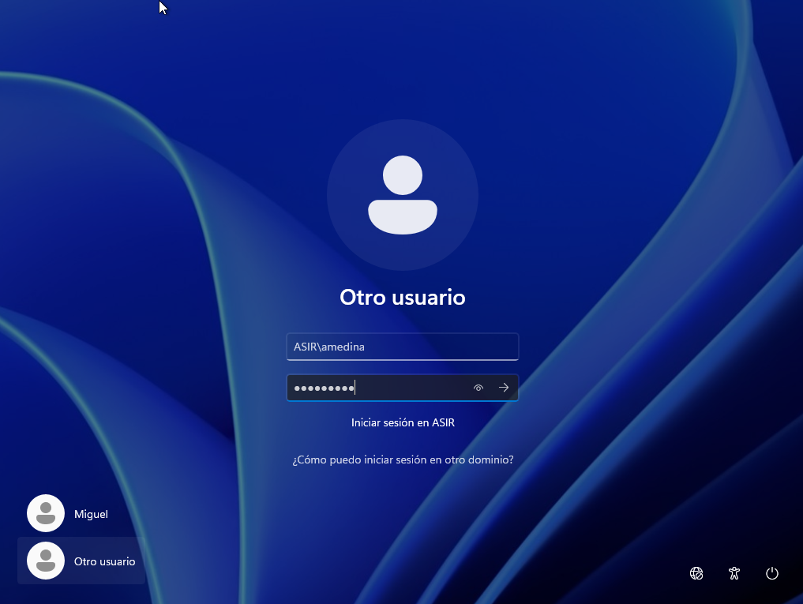
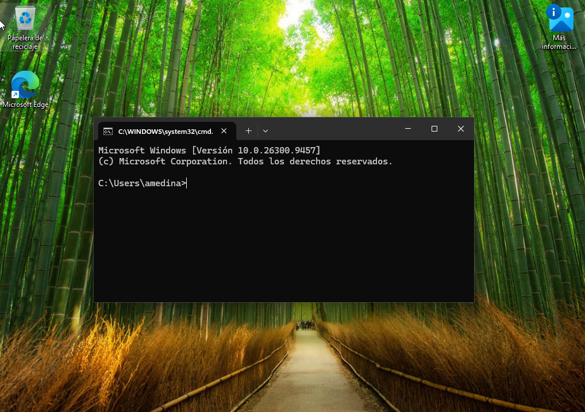

# 06 - Cómo unir un cliente Windows a un dominio de Windows Server

Vamos a ver cómo unir un ordenador con sistema operativo Windows Server al Active Directory de otro Windows Server:

## PASO 1

Ambos equipos deben estar en la misma red interna.
Desde VirtualBox lo configuraremos de la siguiente manera en ambos SSOO:

La red interna y el nombre de ambos equipos debe ser la misma, pero la dirección MAC no.

## PASO 2

En el cliente Windows Server asignaremos una IP estática que esté en la misma red que el Windows Server en que tenemos configurado el Active Directory:

Es importante poner como DNS la IP que tenga el server.

## PASO 3

En nuestro cliente Windows pulsaremos la tecla de Windows + R y en la ventana que se abra pondremos `sysdm.cpl` y ejecutamos. Se nos abrirá **Propiedades del sistema**:

Pulsaremos al botón **Cambiar** y en la nueva ventana que se abra seleccionaremos **Dominio** y pondremos el nombre del dominio, que en mi caso es asir.local.

Tras pulsar **Aceptar**, nos pedirá introducir el usuario y contraseña del administrador del servidor del directorio activo (credenciales de Windows Server).

Si todo es correcto, se mostrará una ventana de confirmación y el sistema nos pedirá reiniciar el equipo:

Una vez reiniciado, pulsaremos en **Otro usuario** e iniciaremos sesión con las credenciales de un usuario que tengamos en Active Directory para probar que funciona:

¡¡CONSEGUIDO!!

