# 07 - Cómo degradar un servidor a cliente de dominio

Para degradar un servidor a cliente de dominio, dentro del **Administrador del servidor** haremos lo siguiente:

**Administrar** → **Quitar roles y funciones**

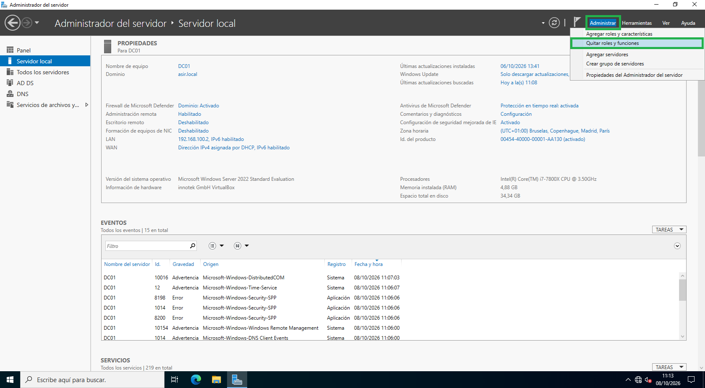
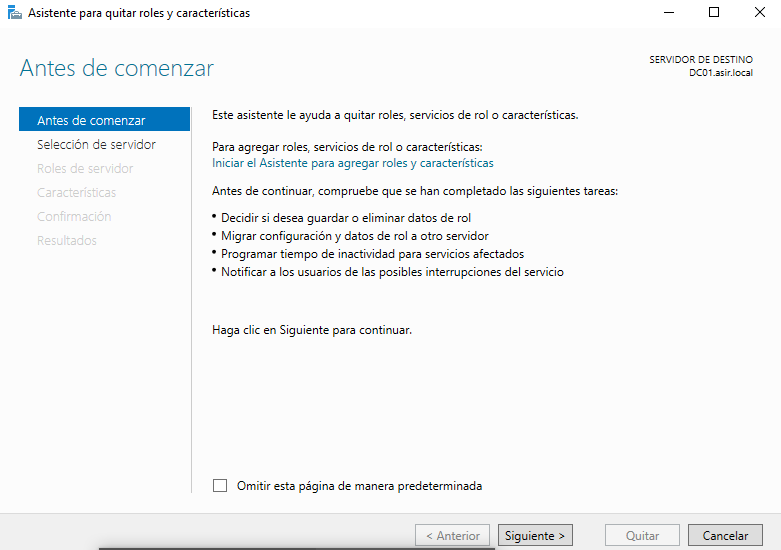
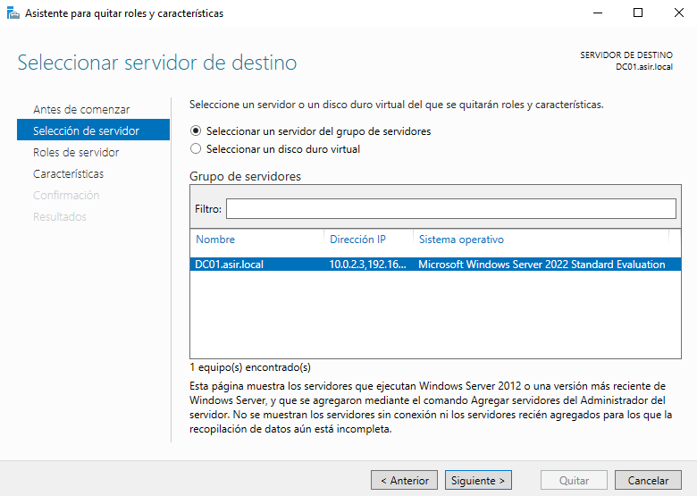

En la siguiente ventana deseleccionaremos la opción **Servicios de dominio de Active Directory**:

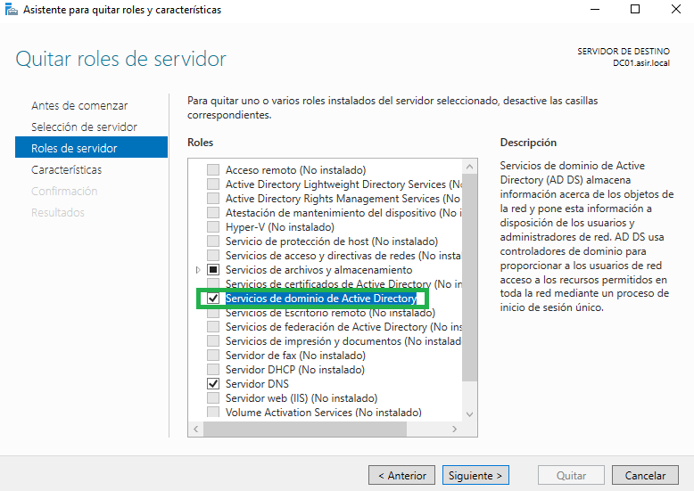

Y se nos abrirá una ventana en la que pulsaremos en **Quitar características**:

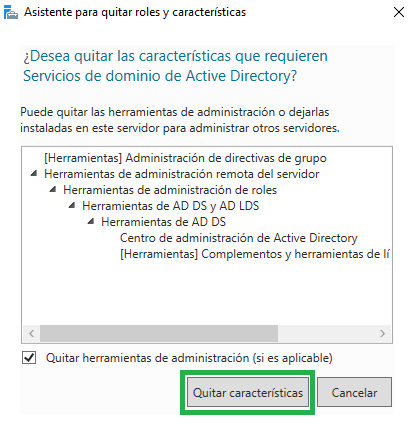

Pulsaremos en Disminuir el nivel de este controlador de dominio:

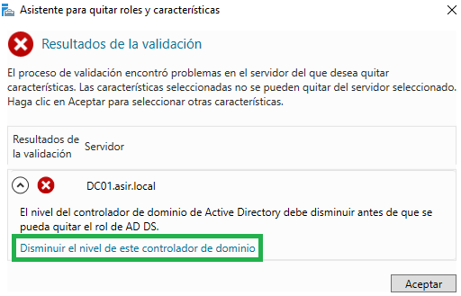

Pulsamos en **Cambiar**:

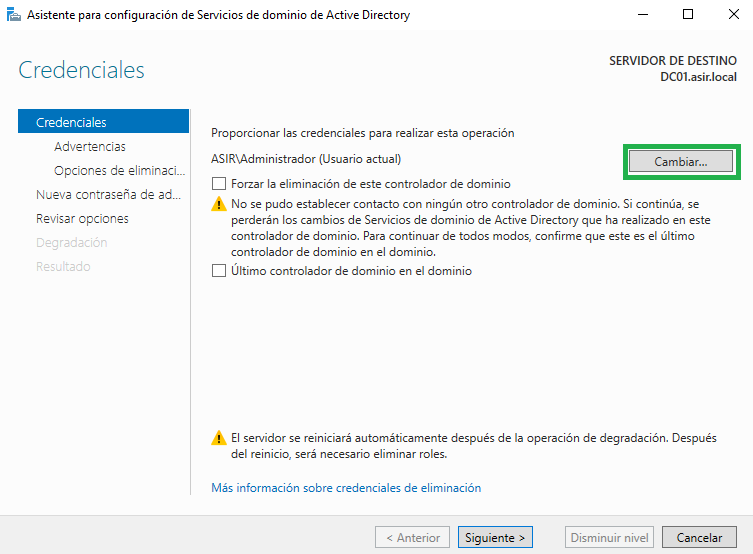

Escribimos las credenciales de administrador:

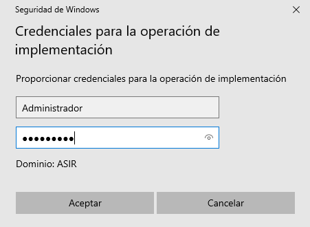

Marcamos el check **Forzar la eliminación de este controlador de dominio**:

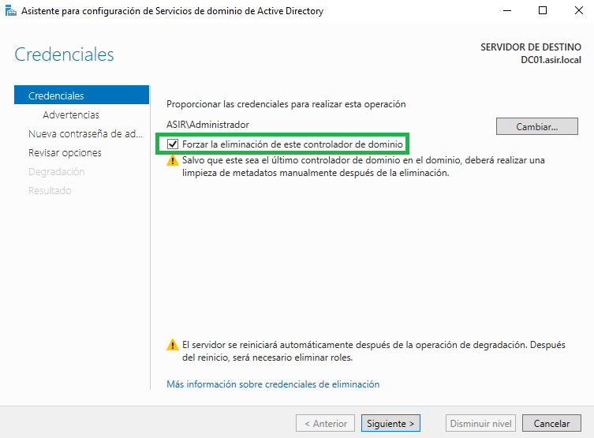

Marcamos **Continuar con la eliminación**:

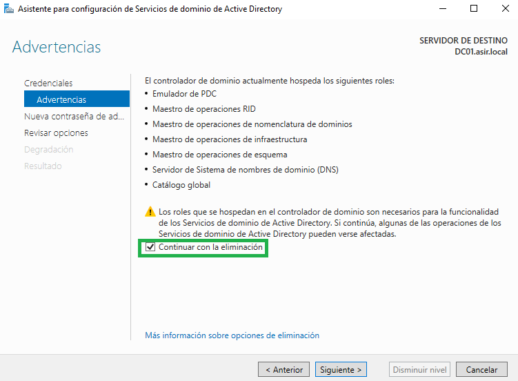

Ponemos la contraseña:

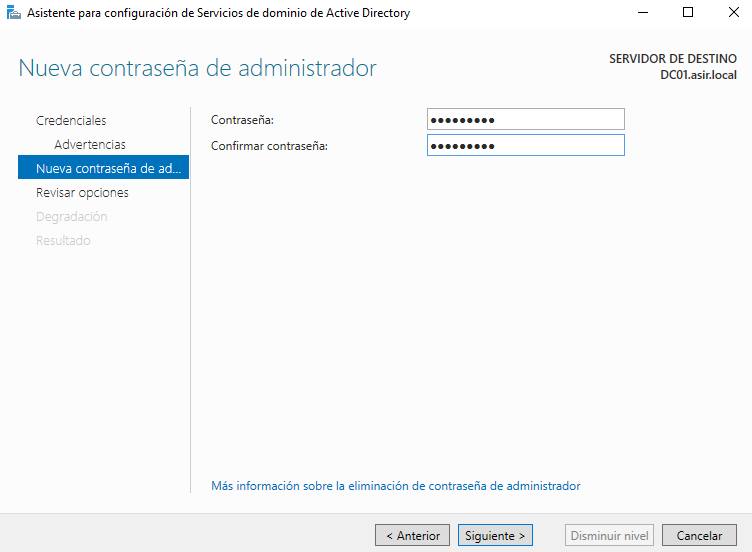
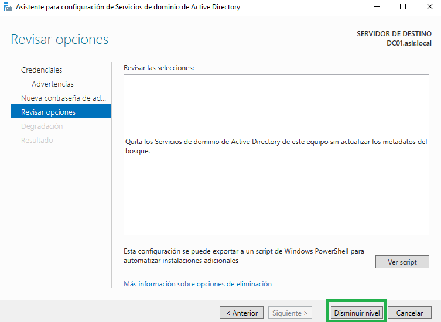

Tras pulsar **Disminuir nivel**, se abrirá otra ventana y el sistema nos pedirá reiniciar el equipo

Una vez hayamos iniciado sesión de nuevo, podremos comprobar que el nombre del grupo de trabajo ha cambiado, ya no se llama **asir.local**

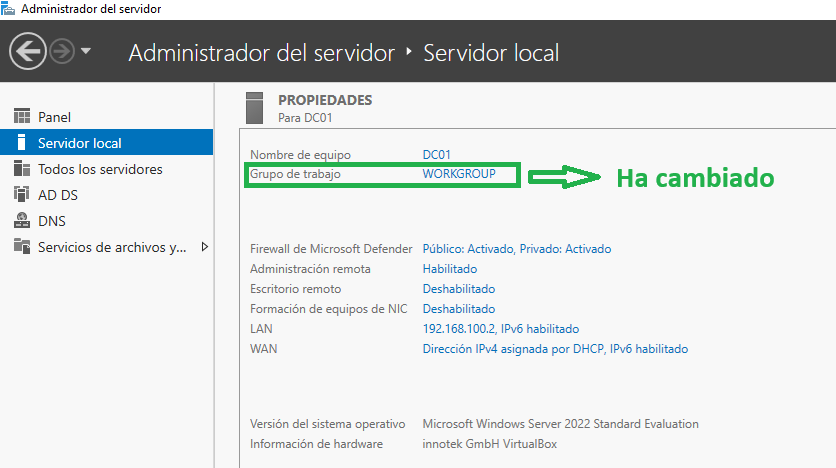