# 08 - Cómo configurar una GPO

Las **GPO (Group Policy Objects u Objetos de Directiva de Grupo)** son una funcionalidad de Windows Server que permite a los administradores configurar y controlar de forma centralizada los equipos y usuarios de un dominio de Active Directory (AD).

Con las GPO se pueden realizar bloqueos de pantalla tras unos minutos de actividad, definir el fondo de pantalla, ocultar el Panel de Control, configurar scripts de inicio de sesión, limitar qué acciones pueden realizar los usuarios en sus equipos...

Lo primero que necesitamos es crear un directorio compartido, donde guardaremos el **fondo.jpg** que queramos.

Para ello, en el servidor, crearemos una nueva carpeta dentro de "C:\\" a la que llamaremos "Imagenes" (sin tilde) y dentro meteremos "fondo.jpg", siendo el directorio completo: **C:\Imagenes\fondo.jpg**

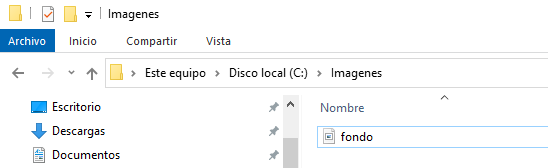

Lo siguiente será hacer click derecho sobre la carpeta "Imagenes" y seleccionaremos "Propiedades". Se abrirá la siguiente ventana:

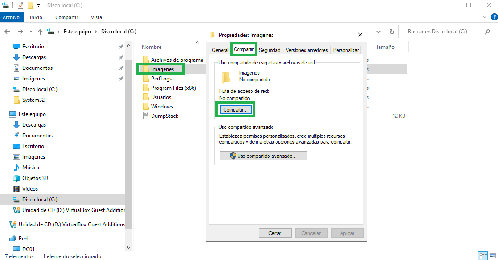

Haremos click en "Compartir" y buscaremos "Todos" pulsaremos en el botón "Añadir". Dejaremos solo el permiso de lectura:

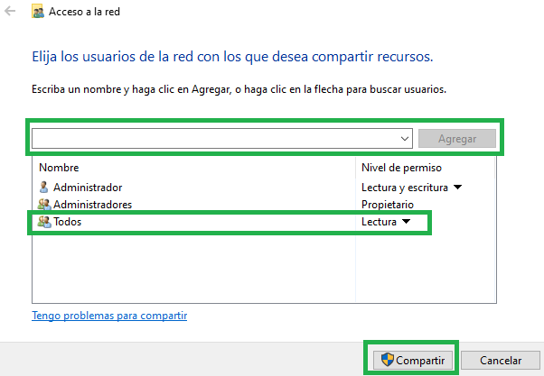

Nos saldrá otra ventana en la que nos mostrará que la ruta pública es **\\\DC01\Imagenes** que es donde está guardado el **fondo.jpng**

Si buscamos la ruta **\\\DC01\Imagenes\fondo.jpg** en Windows 11 debería aparecer la imagen.

A continuación, iremos a Herramientas → Administración de directivas de grupo:

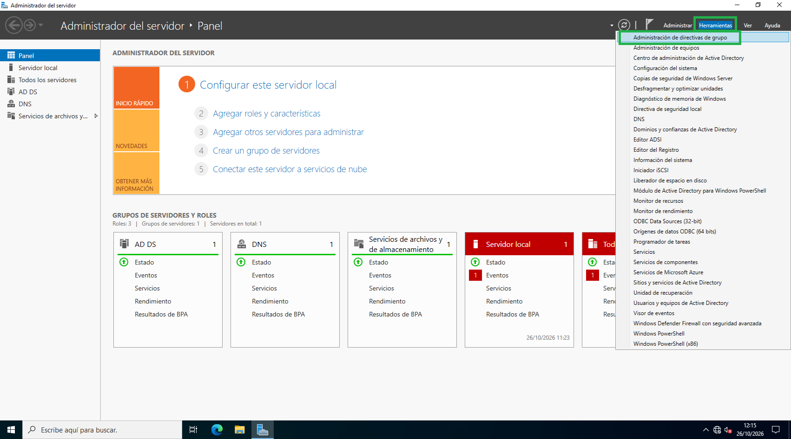

Se nos abrirá una ventana, en la que tendremos que desplegar el directorio "Bosque" y "Dominios". Haremos click en nuestro dominio "asir.local" y seleccionaremos "Crear un GPO en este dominio y vincularlo aquí":

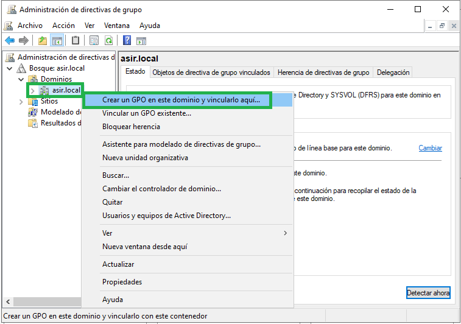

Vamos a crear una directiva llamada "Fondo de pantalla"

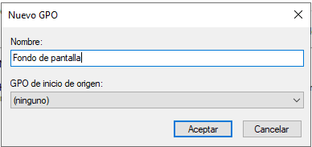

Se nos creará dentro de nuestro dominio:

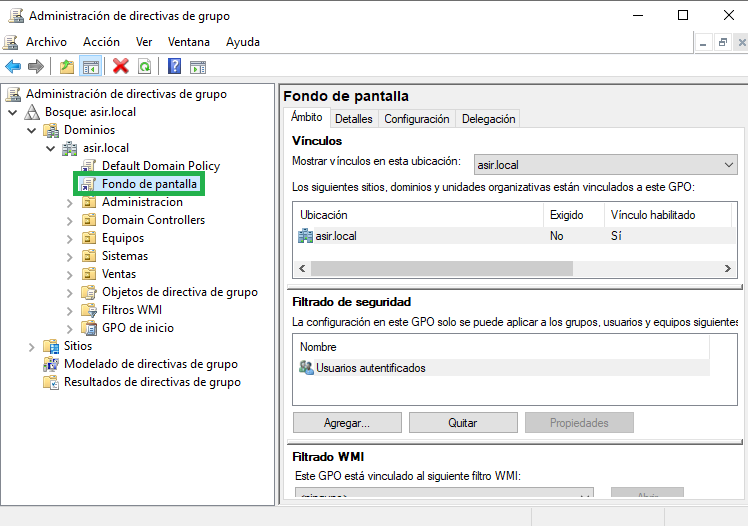

Haremos "click" derecho sobre ella y a continuación "Editar":

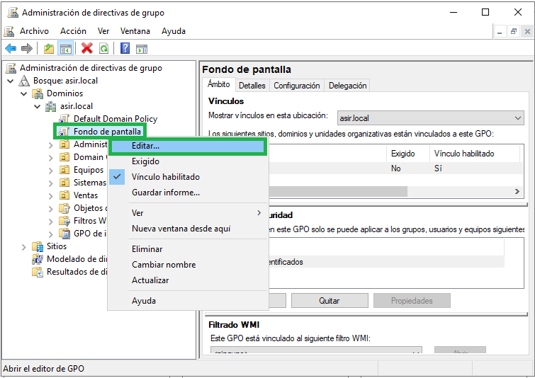

Iremos al directorio mostrado de la siguiente imagen y haremos "click" derecho sobre "Habilitar Active Desktop" y seleccionaremos "Editar":

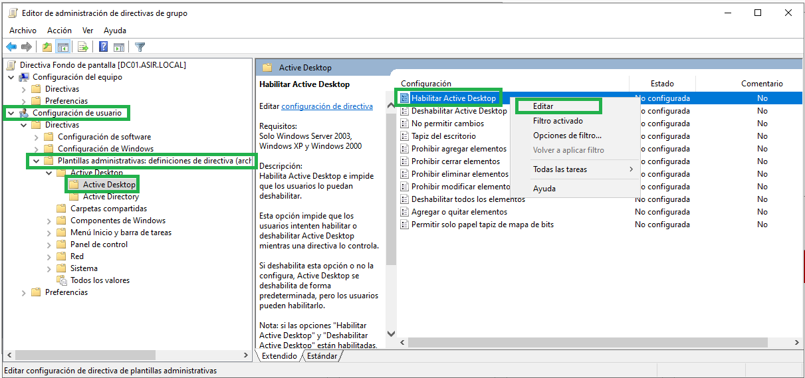

En la nueva ventana que se nos abra, seleccionaremos "Habilitada" y pulsaremos en "Aplicar".

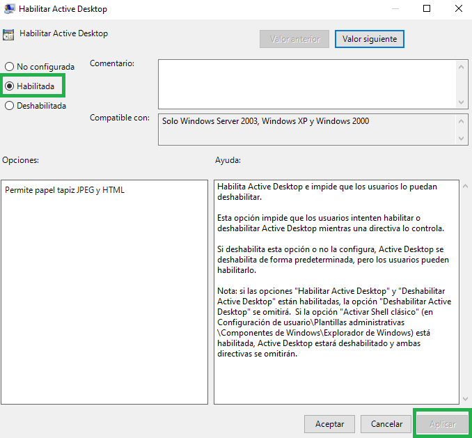

Ahora haremos lo mismo para "Tapiz del escritorio":

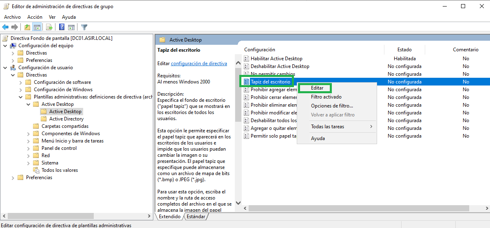

Además de seleccionar "Habilitada" tendremos que especificar la ruta donde esté guardada la imagen de fondo que vayamos a establecer. Y pulsar en "Aplicar" y "Aceptar".

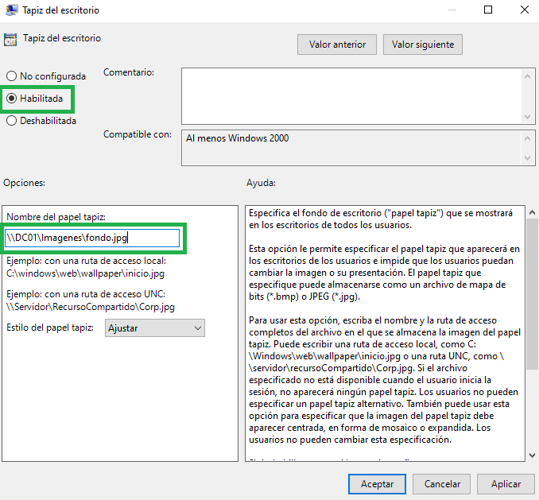

Lo siguiente será vincular la GPO a una Unidad Organizativa en la que haya usuarios, por ejemplo, yo la aplicaré a "Ventas":

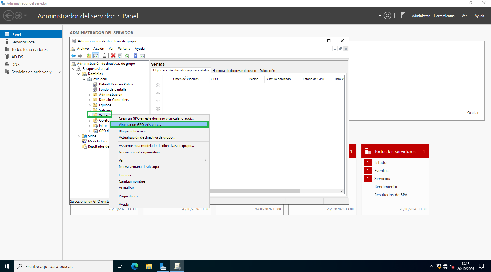

En la ventana que se abra, seleccionaremos la GPO deseada y pulsaremos en "Aceptar":

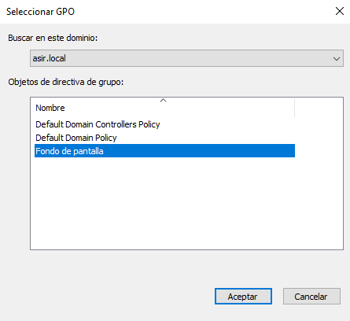

Si desde el cliente Windows 11, abrimos una terminal y escribimos **gpupdate /force** y reiniciamos con un usuario de la OU "Ventas", el fondo de escritorio será el que hemos definido en la GPO.

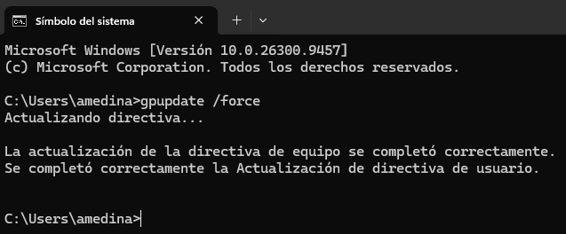

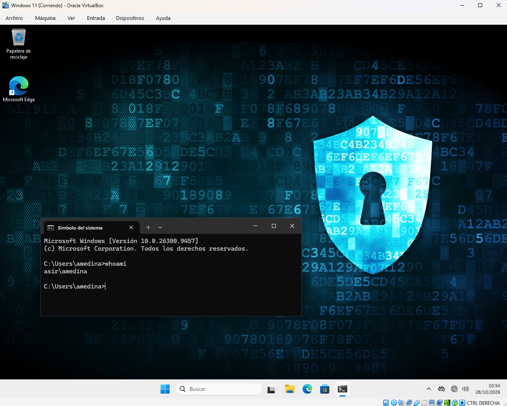